# ITP 141 Lab 3 — Screenshot Documentation

**Laboratory Exercise:** Application Deployment with Docker Compose and IIS on Windows Server**Purpose:** Store and label screenshots for all executed commands and required evidence.

> Replace each placeholder image path with your actual screenshot filename.
> Recommended format: `screenshots/stepX_YY_description.png`

---

# Step 1 — Install Docker CE and Docker Compose

## Screenshot 1.1 — Docker Repository Setup

Follow Docker's official Ubuntu installation procedure to add Docker's GPG key and APT repository.

**Capture:** Terminal showing the Docker repository was added successfully.

**Label:** `Figure 1.1 — Docker repository setup`

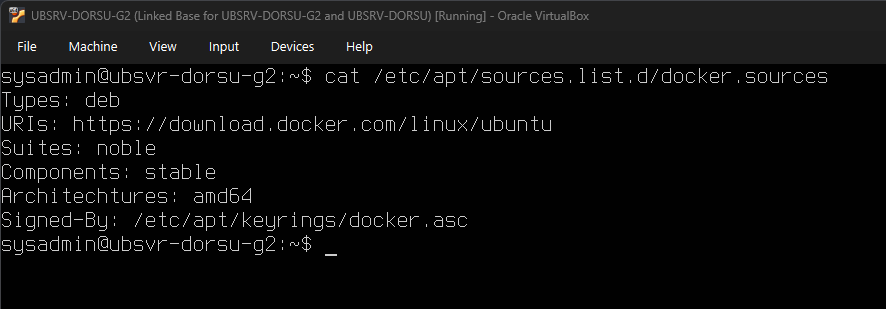

---

## Screenshot 1.2 — Install Docker CE Packages

Run:

```bash
sudo apt install docker-ce docker-ce-cli containerd.io docker-buildx-plugin docker-compose-plugin -y
```

**Capture:** Successful installation of Docker CE, Docker CLI, containerd, Buildx, and the Compose plugin.

**Label:** `Figure 1.2 — Docker CE package installation`

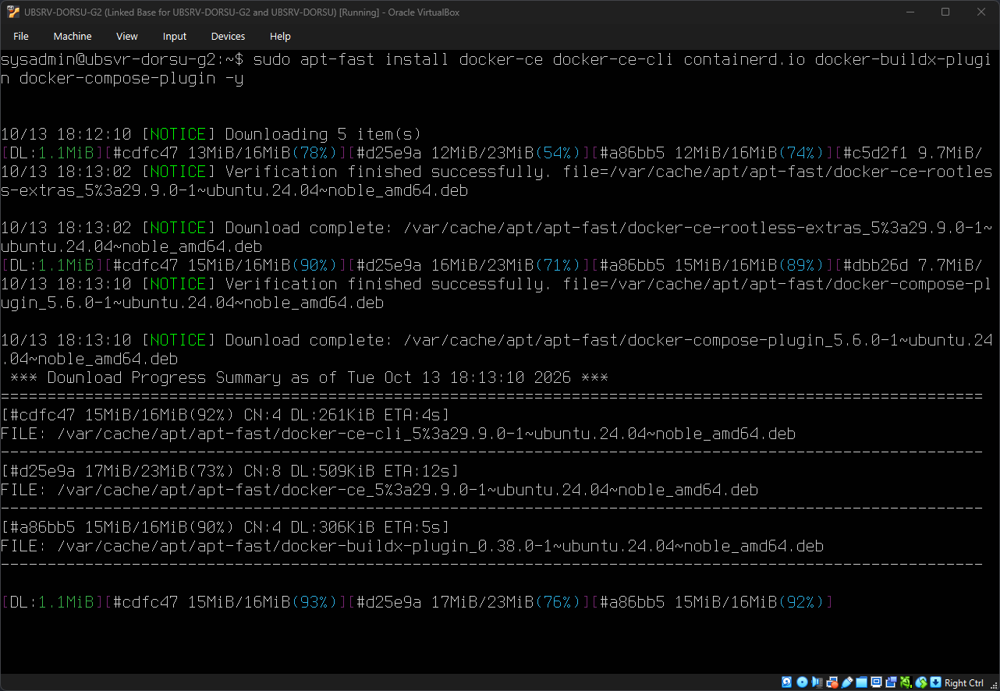

---

## Screenshot 1.3 — Add `sysadmin` to the Docker Group

Run:

```bash
sudo usermod -aG docker sysadmin
newgrp docker
```

**Capture:** Commands completed without errors.

**Label:** `Figure 1.3 — sysadmin added to docker group`

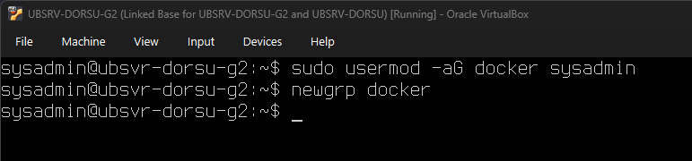

> Record in the worksheet that Docker group membership is effectively equivalent to root access and should only be granted to administrators.

---

## Screenshot 1.4 — Verify Docker and Compose Versions

Run:

```bash
docker --version && docker compose version
```

**Capture:** Docker Engine and Docker Compose versions.

**Label:** `Figure 1.4 — Docker and Compose versions`

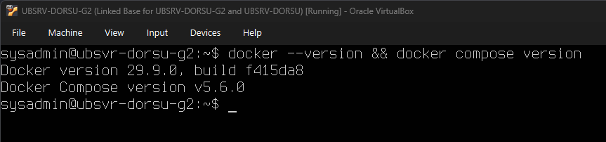

---

# Step 2 — Pull Version-Pinned Images

## Screenshot 2.1 — Pull Required Images

Run:

```bash
docker pull nginx:1.28-alpine && docker pull php:8.4-fpm-alpine && docker pull mariadb:11.4
```

**Capture:** Successful pulls for Nginx, PHP-FPM, and MariaDB.

**Label:** `Figure 2.1 — Required Docker images pulled`

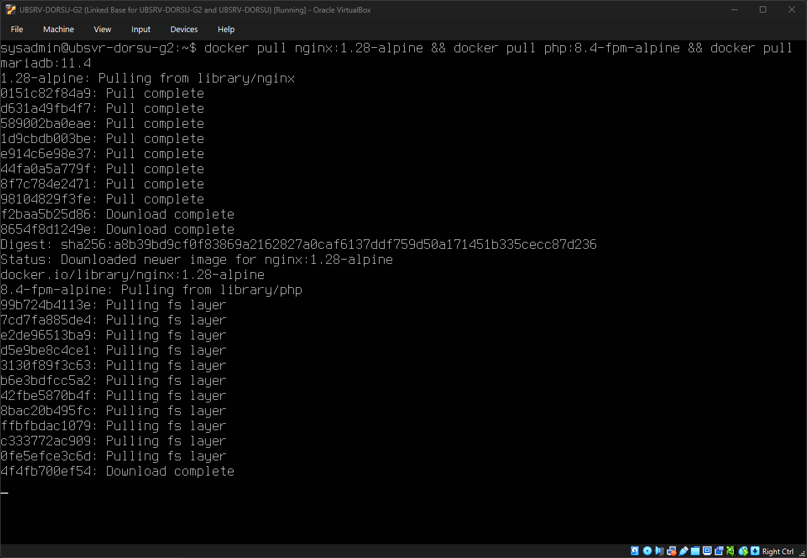

> Do not use `latest`. If `nginx:1.28-alpine` is unavailable, use a current stable Nginx version and record the replacement tag.

---

## Screenshot 2.2 — Verify Docker Images

Run:

```bash
docker images
```

**Capture:** Listing showing the three required version-pinned images.

**Label:** `Figure 2.2 — Docker image inventory`

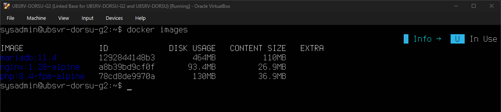

---

# Step 3 — Create the Docker Compose Configuration

Create the deployment directory:

```bash
mkdir -p ~/lab3_deploy
cd ~/lab3_deploy
```

Create:

```bash
nano docker-compose.yml
```

The Compose file must contain:

- `webserver` using `nginx:1.28-alpine`
- Host port `8080:80`
- `./html:/var/www/html`
- `app` using `php:8.4-fpm-alpine`
- `db` using `mariadb:11.4`
- `MARIADB_ROOT_PASSWORD=DOrSU2026`
- Named volume `db_data:/var/lib/mysql`
- No published port for MariaDB
- MariaDB health check
- `depends_on` for the application service

## Screenshot 3.1 — Docker Compose YAML

Run:

```bash
cat ~/lab3_deploy/docker-compose.yml
```

**Capture:** Complete `docker-compose.yml` showing all three services and required settings.

**Label:** `Figure 3.1 — Docker Compose configuration`

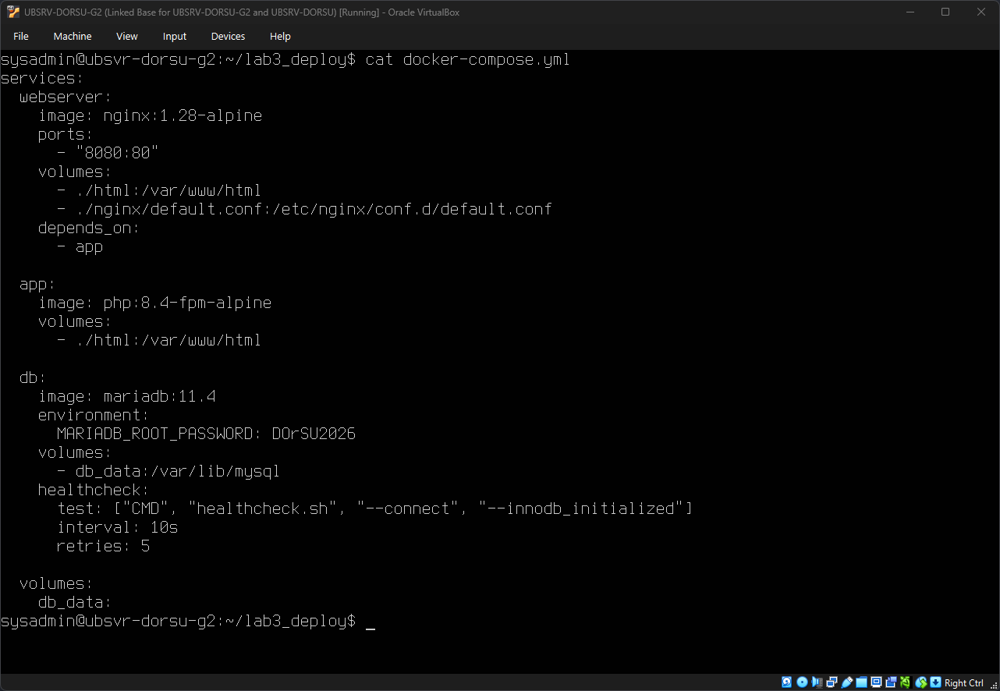

---

# Step 4 — Configure PHP, Nginx, and Start the Stack

Create the required directories:

```bash
mkdir -p ~/lab3_deploy/html
mkdir -p ~/lab3_deploy/nginx
```

Create the PHP test page:

```bash
nano ~/lab3_deploy/html/index.php
```

Create the Nginx configuration:

```bash
nano ~/lab3_deploy/nginx/default.conf
```

The Nginx PHP configuration must include:

```text
root /var/www/html;
index index.php;
fastcgi_pass app:9000;
fastcgi_index index.php;
fastcgi_param SCRIPT_FILENAME $document_root$fastcgi_script_name;
include fastcgi_params;
```

## Screenshot 4.1 — PHP Test Page

Run:

```bash
cat ~/lab3_deploy/html/index.php
```

**Capture:** PHP source showing the DOrSU BSIT Lab 3 heading and `phpversion()`.

**Label:** `Figure 4.1 — PHP test page`

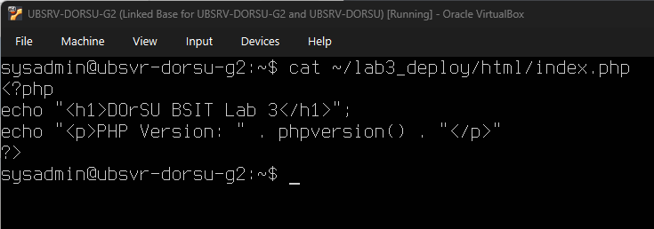

---

## Screenshot 4.2 — Nginx PHP-FPM Configuration

Run:

```bash
cat ~/lab3_deploy/nginx/default.conf
```

**Capture:** Nginx configuration showing `/var/www/html` and `fastcgi_pass app:9000`.

**Label:** `Figure 4.2 — Nginx PHP-FPM configuration`

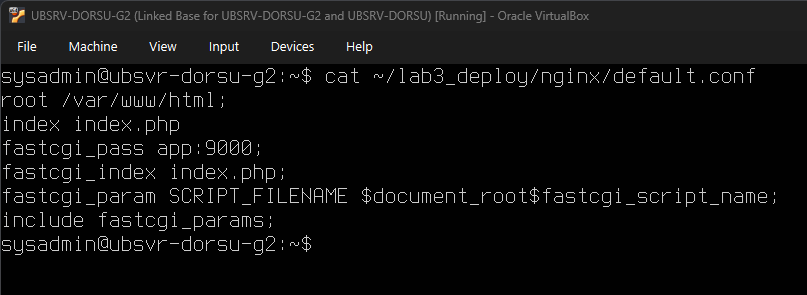

---

## Screenshot 4.3 — Start the Compose Stack

Run:

```bash
cd ~/lab3_deploy
docker compose up -d
```

**Capture:** Three containers created and started.

**Label:** `Figure 4.3 — Docker Compose stack started`

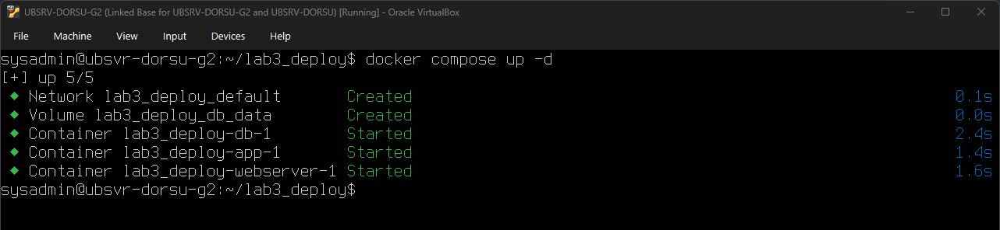

---

## Screenshot 4.4 — PHP Page from Windows Guest

From the Windows guest, browse to:

```text
http://192.168.10.12:8080
```

**Capture:** Rendered DOrSU BSIT Lab 3 PHP page.

**Label:** `Figure 4.4 — PHP page accessed from Windows guest`

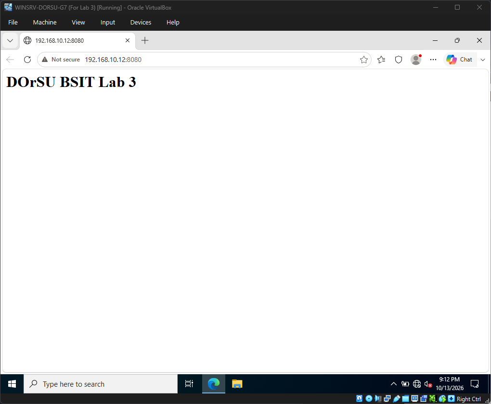

---

## Screenshot 4.5 — PHP Page from Host

From the host machine, browse to:

```text
http://192.168.10.12:8080
```

**Capture:** Rendered PHP page accessed from the host.

**Label:** `Figure 4.5 — PHP page accessed from host`

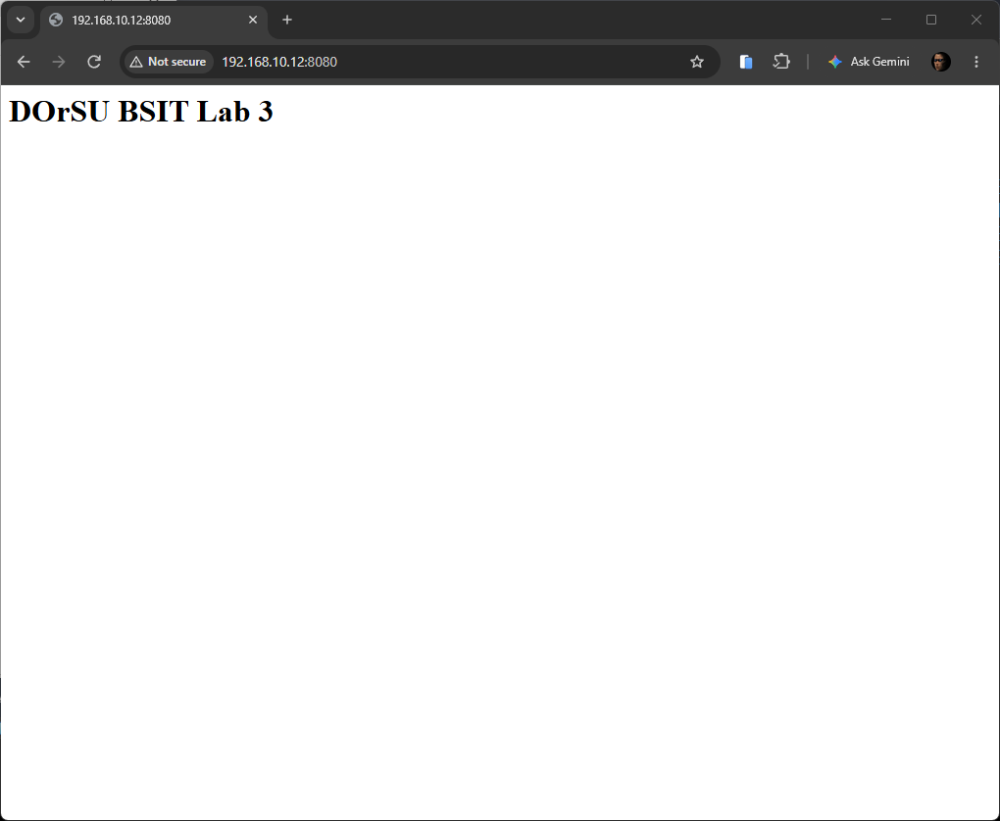

---

# Step 5 — Create and Execute `deploy.sh`

Create:

```bash
nano ~/lab3_deploy/deploy.sh
```

The script must include:

- `#!/usr/bin/env bash`
- `set -Eeuo pipefail`
- `cd "$(dirname "$0")"`
- rollback function
- `trap 'rollback $LINENO' ERR`
- `docker compose pull`
- `docker compose up -d`
- Health-check loop using `curl`
- Up to 10 attempts
- `sleep 3` between attempts
- Explicit rollback if the health check fails after all attempts

## Screenshot 5.1 — `deploy.sh` Source

Run:

```bash
cat ~/lab3_deploy/deploy.sh
```

**Capture:** Complete script showing strict mode, rollback trap, deployment commands, and health-check loop.

**Label:** `Figure 5.1 — deploy.sh automation script`

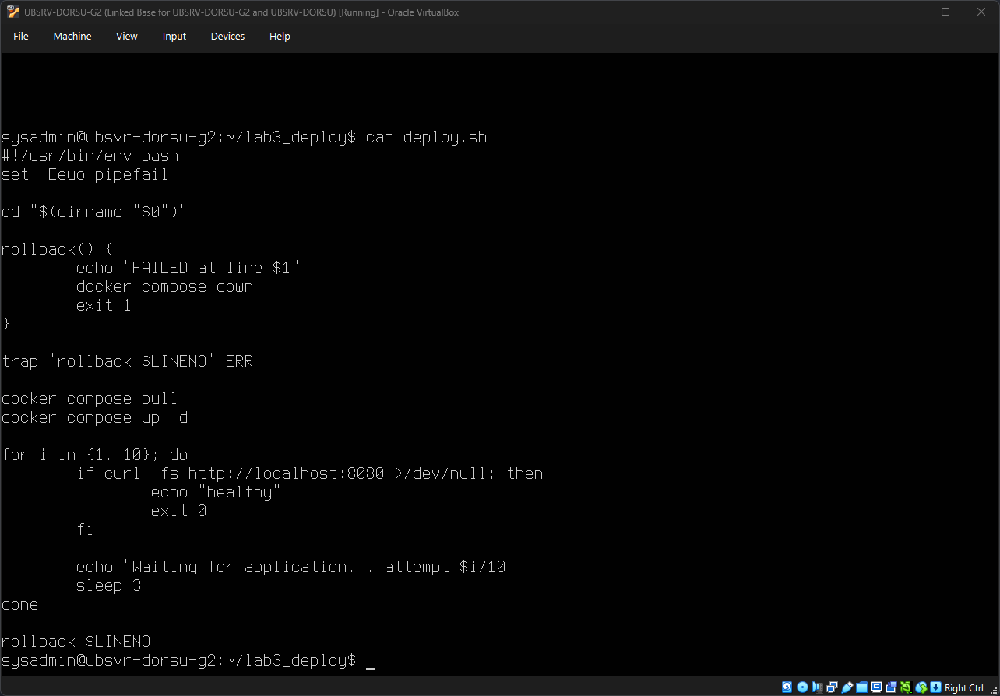

---

## Screenshot 5.2 — Make `deploy.sh` Executable

Run:

```bash
cd ~/lab3_deploy
chmod +x deploy.sh
ls -l deploy.sh
```

**Capture:** File permissions showing the executable bit.

**Label:** `Figure 5.2 — deploy.sh executable permission`

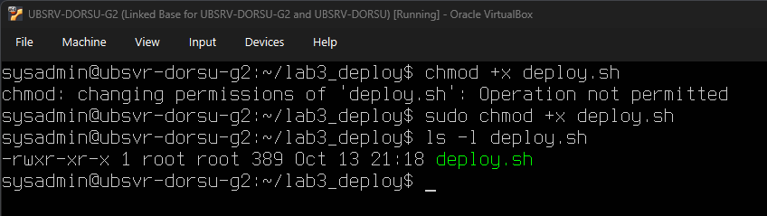

---

## Screenshot 5.3 — Execute `deploy.sh`

Run:

```bash
./deploy.sh
```

**Capture:** Successful deployment and healthy application result.

**Label:** `Figure 5.3 — deploy.sh execution`

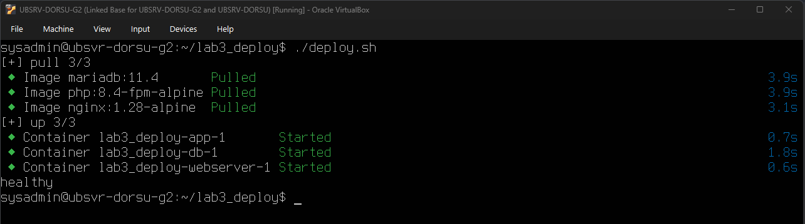

---

# Step 6 — Verify Container Health and Logs

## Screenshot 6.1 — Container Health

Run:

```bash
docker compose ps
```

**Capture:** All three services showing `Up`, with the database showing `Up (healthy)`.

**Label:** `Figure 6.1 — Docker Compose container health`

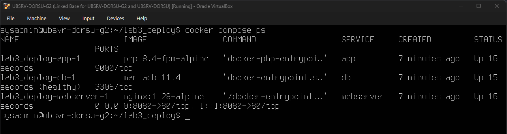

---

## Screenshot 6.2 — Webserver Logs

Run:

```bash
docker compose logs webserver | tail -10
```

**Capture:** Last ten Nginx log entries without critical startup errors.

**Label:** `Figure 6.2 — Nginx webserver logs`

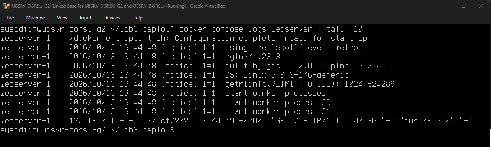

---

## Screenshot 6.3 — Container IP Addresses

Use the actual container names shown by `docker compose ps`.

Run for each container:

```bash
docker inspect -f '{{range .NetworkSettings.Networks}}{{.IPAddress}}{{end}}' <container-name>
```

**Capture:** IP addresses for the `webserver`, `app`, and `db` containers.

**Label:** `Figure 6.3 — Docker container IP addresses`

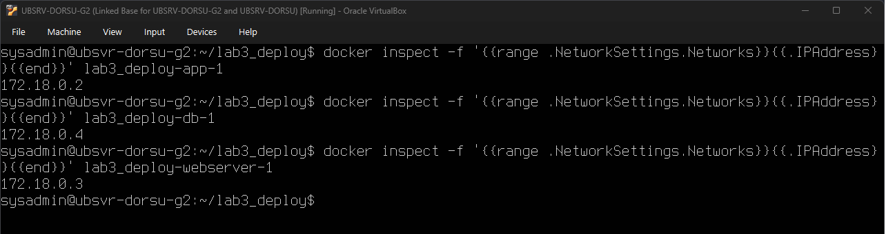

---

# Step 7 — Install and Configure IIS on Windows Server

Install through:

```text
Server Manager
→ Add Roles and Features
→ Web Server (IIS)
```

Enable:

- HTTP Redirection
- Static Content

Create the IIS site:

```text
Site name: DOrSU_Test
Physical path: C:\inetpub\DOrSU
Port: 8080
```

Create:

```text
C:\inetpub\DOrSU\index.htm
```

## Screenshot 7.1 — IIS Role and Features

**Capture:** Server Manager showing Web Server (IIS), HTTP Redirection, and Static Content installed.

**Label:** `Figure 7.1 — IIS role and required features`

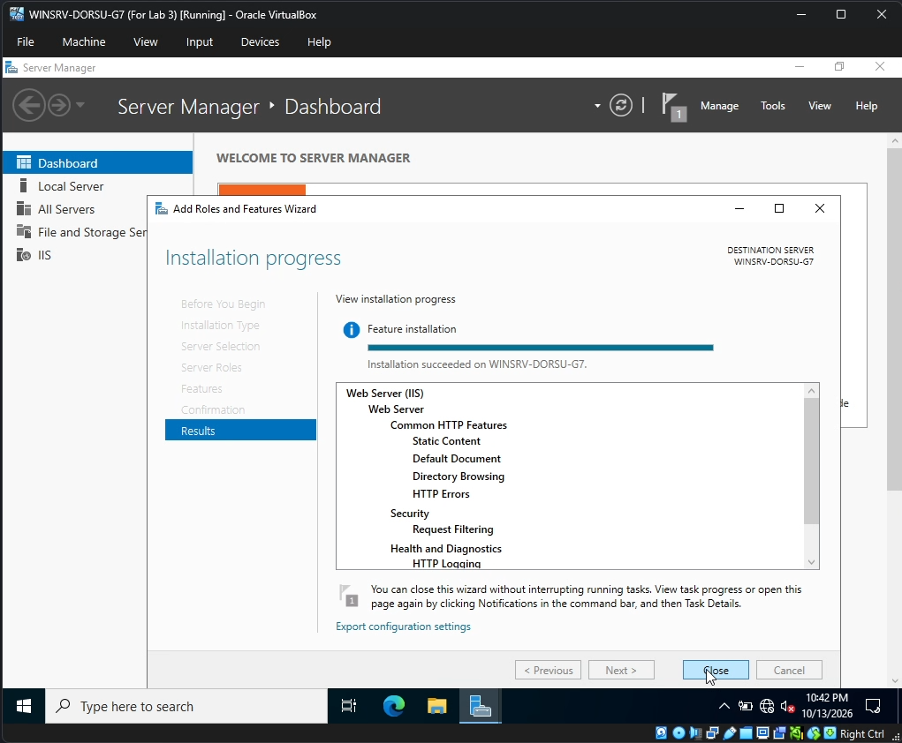

---

## Screenshot 7.2 — IIS `DOrSU_Test` Site

**Capture:** IIS Manager showing `DOrSU_Test` configured on port `8080`.

**Label:** `Figure 7.2 — DOrSU_Test IIS site configuration`

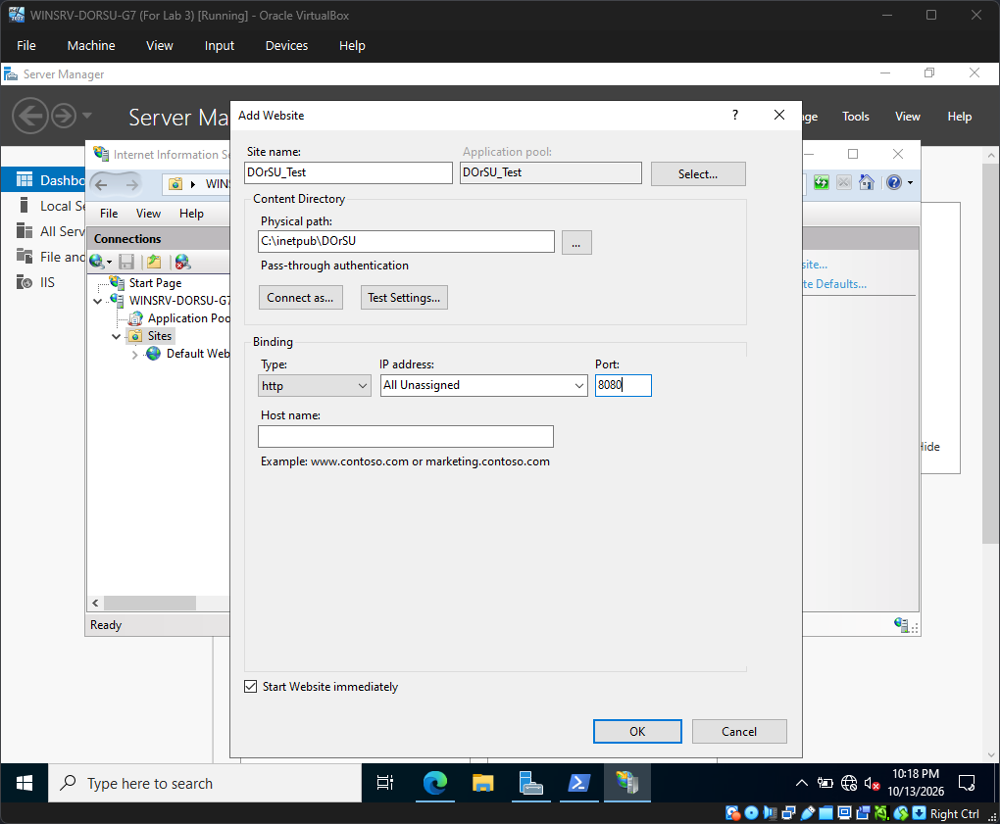

---

## Screenshot 7.3 — Windows Firewall Rule for Port 8080

Open PowerShell as Administrator.

Run:

```powershell
New-NetFirewallRule -DisplayName "IIS DOrSU_Test 8080" -Direction Inbound -Protocol TCP -LocalPort 8080 -Action Allow
```

**Capture:** Successful firewall rule creation.

**Label:** `Figure 7.3 — IIS port 8080 firewall rule`

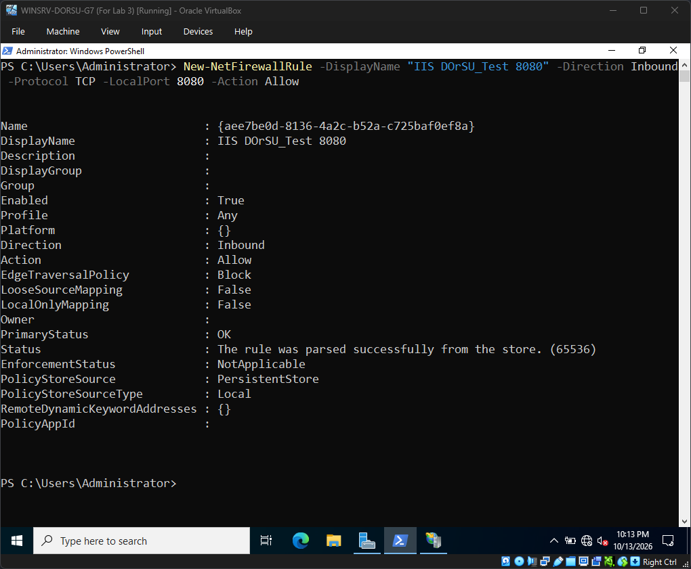

---

## Screenshot 7.4 — IIS Local Browser Test

Browse on the Windows Server guest:

```text
http://localhost:8080
```

**Capture:** DOrSU BSIT Lab 3 IIS page loaded locally.

**Label:** `Figure 7.4 — IIS local browser validation`

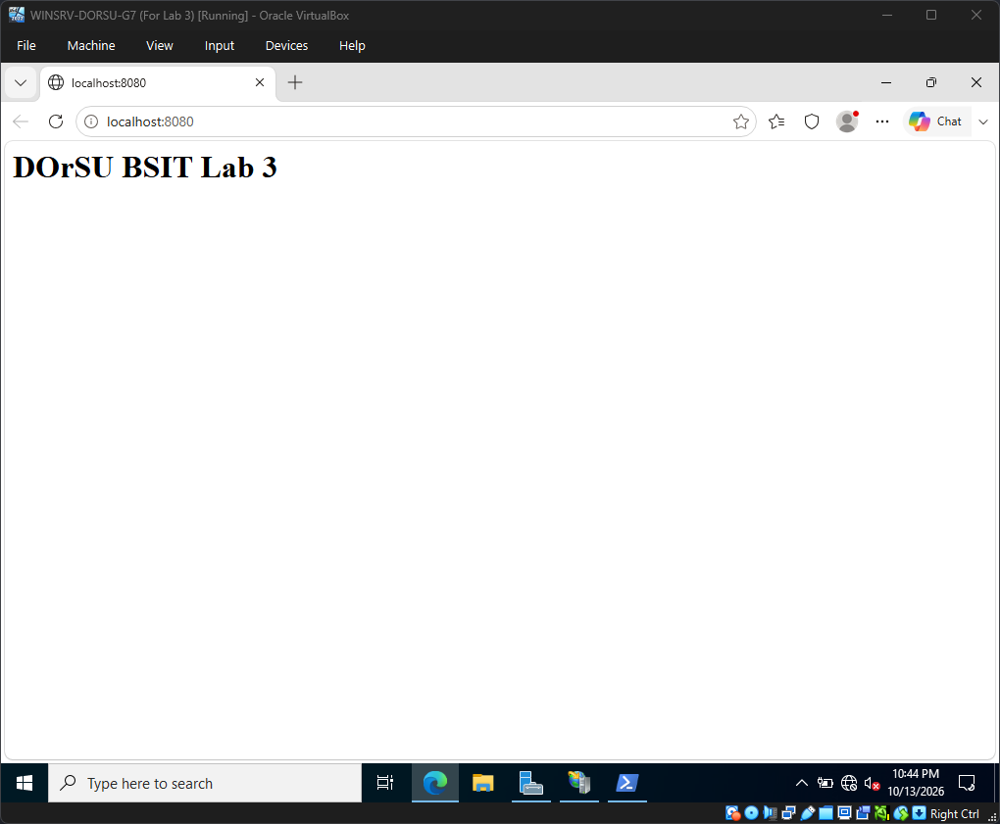

---

## Screenshot 7.5 — IIS Test from Ubuntu

From Ubuntu, run:

```bash
curl http://192.168.10.11:8080
```

**Capture:** IIS page content returned through `curl`.

**Label:** `Figure 7.5 — IIS connectivity from Ubuntu`

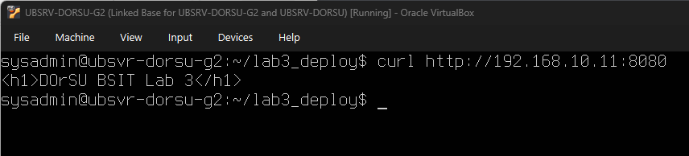

---

# Step 8 — Run the Four Validation Checks

## Screenshot 8.1 — Deploy Validation

Run:

```bash
./deploy.sh
echo $?
```

**Capture:** Successful deployment with exit code `0`.

**Label:** `Figure 8.1 — Deploy validation`

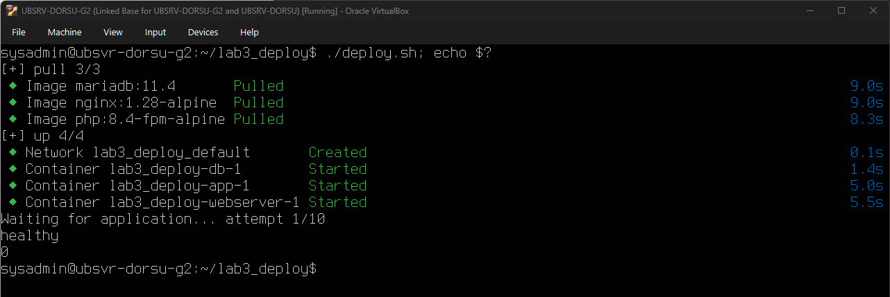

---

## Screenshot 8.2 — HTTP Smoke Test

Run:

```bash
curl -I http://localhost:8080
```

**Capture:** HTTP response showing status `200`.

**Label:** `Figure 8.2 — HTTP 200 smoke test`

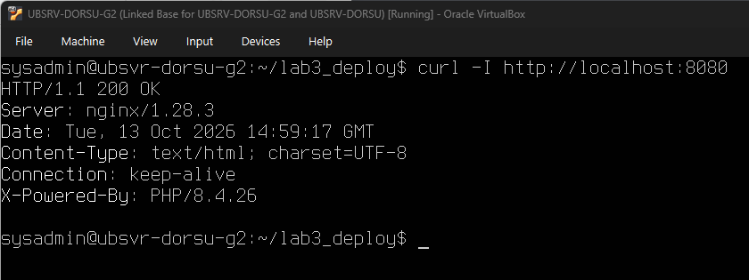

---

## Screenshot 8.3 — Verify Port 8080

Run:

```bash
sudo ss -tlnp | grep 8080
```

**Capture:** Port `8080` listening through Docker/docker-proxy.

**Label:** `Figure 8.3 — Docker port 8080 verification`

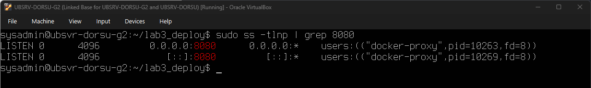

---

## Screenshot 8.4 — Verify MariaDB Port 3306 Is Not Exposed

Run:

```bash
sudo ss -tlnp | grep 3306
```

**Expected result:** No output.

**Capture:** Terminal showing the command and no matching listener on host port `3306`.

**Label:** `Figure 8.4 — MariaDB port 3306 not exposed`

---

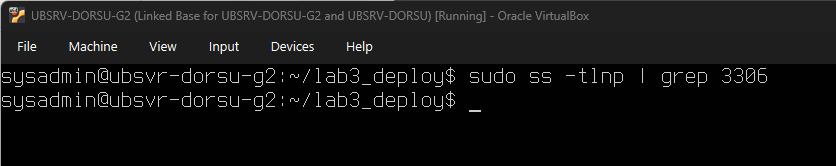

## Screenshot 8.5 — Docker Compose Log Review

Run:

```bash
docker compose logs
```

**Capture:** Container startup logs without deployment-breaking errors.

**Label:** `Figure 8.5 — Docker Compose log review`

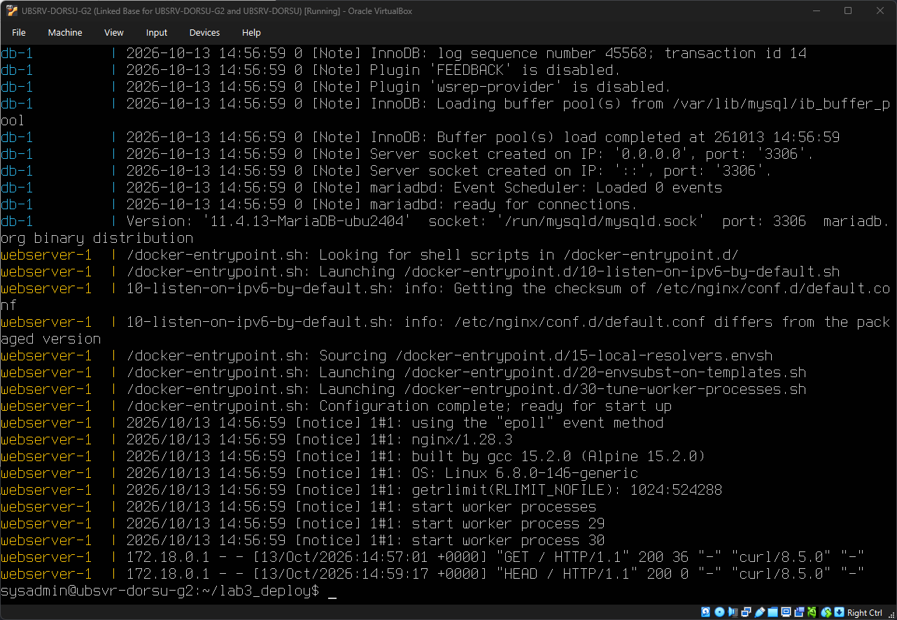

---

## Screenshot 8.6 — Create Persistence Test Data

Run:

```bash
docker compose exec db mariadb -uroot -pDOrSU2026 -e "CREATE DATABASE lab3; CREATE TABLE lab3.t (v VARCHAR(20)); INSERT INTO lab3.t VALUES ('persist');"
```

**Capture:** Command completed successfully without SQL errors.

**Label:** `Figure 8.6 — MariaDB persistence test data created`

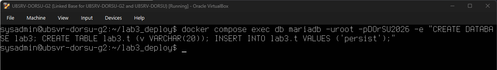

---

## Screenshot 8.7 — Recreate the Compose Stack

Run:

```bash
docker compose down && docker compose up -d
```

**Capture:** Stack stopped and successfully recreated.

**Label:** `Figure 8.7 — Docker stack recreated`

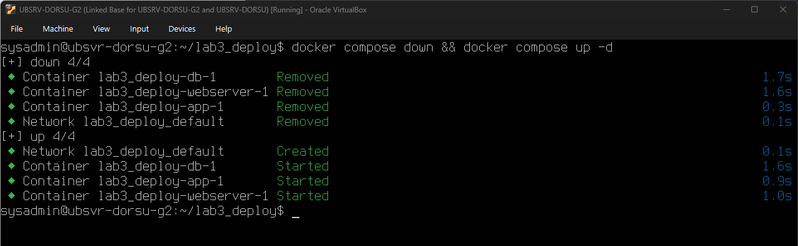

> Do not use `docker compose down -v`. The `-v` option deletes the named volume and destroys the persistence evidence.

---

## Screenshot 8.8 — Verify Persistent Data

Run:

```bash
docker compose exec db mariadb -uroot -pDOrSU2026 -e "SELECT * FROM lab3.t;"
```

**Expected result:**

```text
persist
```

**Capture:** Query result showing that the `persist` row survived the container recreation.

**Label:** `Figure 8.8 — MariaDB named-volume persistence`

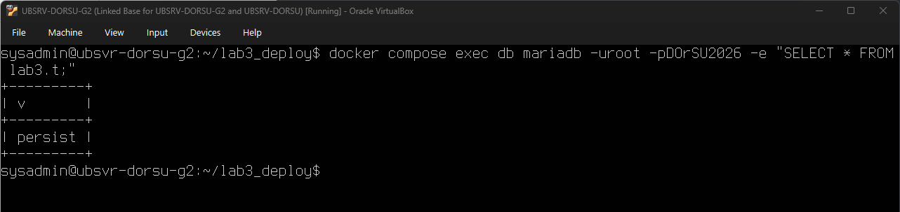
