# ITP 141 — Laboratory Exercise 4 Screenshot Documentation

**Lab 4:** Active Directory DS, RBAC, Linux User Management, and `auditd`**Platforms:** Windows Server 2022 + Ubuntu Server 24.04 LTS**Purpose:** Store and label screenshots for every major Lab 4 step, including executed commands, configuration screens, verification results, and required worksheet evidence.

> **Screenshot rule:** Capture the **command/configuration and its result in the same screenshot whenever possible**. Do not crop away the terminal prompt, window title, GPO/OU path, or other context needed to verify what was done.
>
> **Recommended folder:** Save images in a `screenshots/` folder beside this Markdown file using the filenames shown below.

---

# STEP 1 — Member 1: Install AD DS and Promote the Windows Server

## 1.1 Take a VirtualBox Snapshot First

Before promoting the server, take a snapshot of the Windows Server 2022 VM.

**Suggested snapshot name:**

```text
Before Lab 4 AD DS Promotion
```

**Screenshot 01 — VirtualBox snapshot before AD DS promotion**

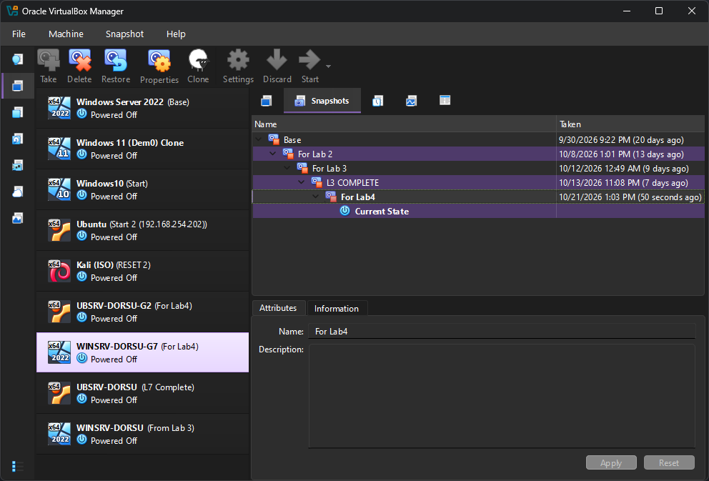

**What must be visible:**

- VM name
- Snapshot name
- Snapshot tree showing the snapshot was created before promotion

---

## 1.2 Install Active Directory Domain Services

Open:

```text
Server Manager
→ Manage
→ Add Roles and Features
→ Role-based or feature-based installation
→ Select this server
→ Active Directory Domain Services
→ Add Features
→ Install
```

After installation, select:

```text
Promote this server to a domain controller
```

Choose:

```text
Add a new forest
Root domain name: dorsu.lab
```

Set the DSRM password specified by the laboratory instructions.

Use a **group-unique NetBIOS name**, for example:

```text
DORSUG7
```

> The DNS delegation warning for the `.lab` domain is expected in this laboratory setup.

**Screenshot 02 — AD DS installed / promotion configuration**

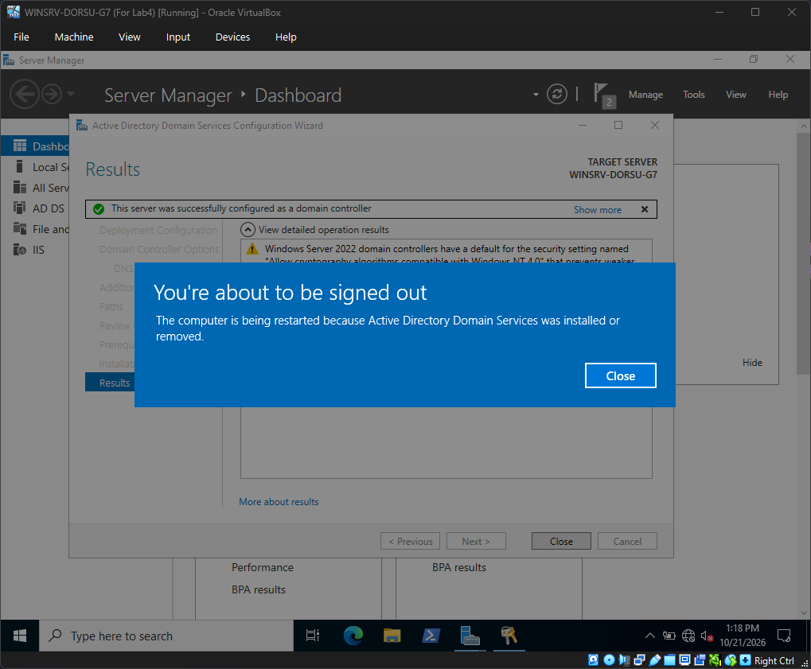

**What must be visible:**

- AD DS selected/installed
- `dorsu.lab`
- New forest selection or promotion summary
- Group-specific NetBIOS name if visible

> Do **not** expose the DSRM password in a screenshot.

---

## 1.3 Verify the Domain After Reboot

After the server reboots:

```text
Server Manager
→ Tools
→ Active Directory Users and Computers
```

Expand the domain tree and verify:

```text
dorsu.lab
```

**Screenshot 03 — ADUC showing the `dorsu.lab` root**

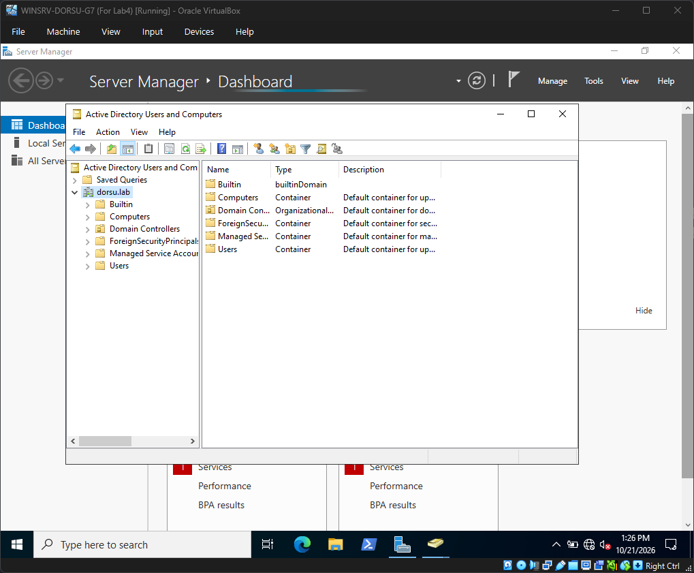

---

## 1.4 Set the Domain Controller DNS to Itself

Open the IPv4 properties of the **bridged network adapter** and set:

```text
Preferred DNS server: 127.0.0.1
```

**Screenshot 04 — Domain controller preferred DNS = `127.0.0.1`**

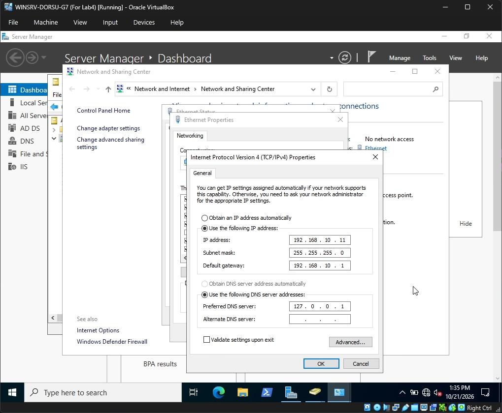

Then open Command Prompt or PowerShell and run:

```powershell
nslookup dorsu.lab
```

**Screenshot 05 — `nslookup dorsu.lab` succeeds**

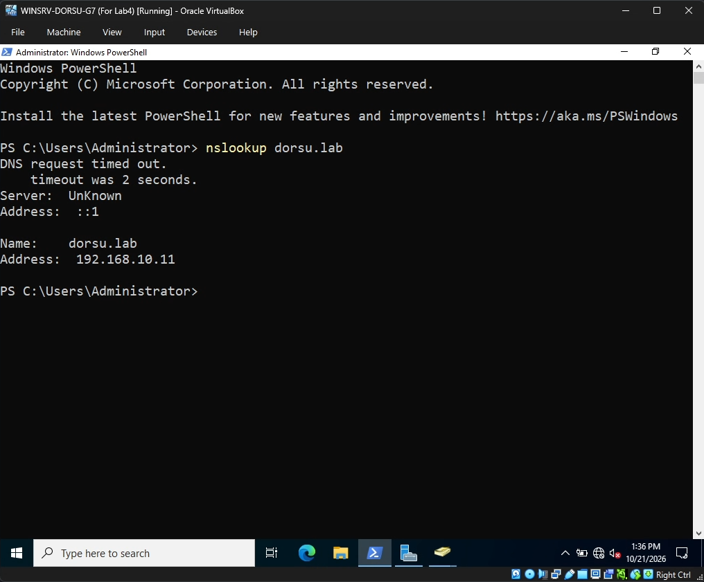

**What must be visible:**

- Command entered
- Returned DNS server/address
- Successful resolution of `dorsu.lab`

---

# STEP 2 — Member 2: Create the OU Structure and Six Users

Open **Active Directory Users and Computers (ADUC)**.

Create the parent OU:

```text
IT_Department
```

Inside it create:

```text
Admins
Developers
HelpDesk
```

Create the users:

### Admins

```text
a.santos
j.reyes
```

### Developers

```text
m.cruz
r.dela-cruz
```

### HelpDesk

```text
l.tan
p.uy
```

Use the password specified by the laboratory instructions when creating the accounts.

**Screenshot 06 — Complete OU tree with all six users**

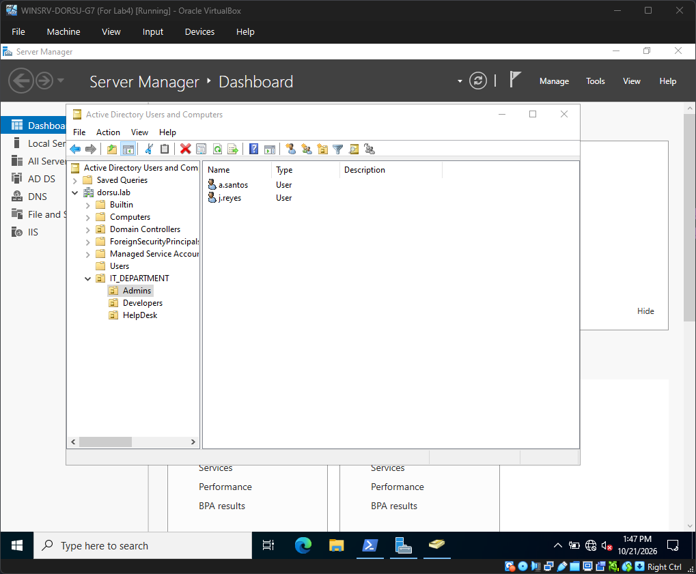

**What must be visible:**

- `dorsu.lab`
- `IT_Department`
- `Admins`
- `Developers`
- `HelpDesk`
- Two users inside each role OU

---

# STEP 3 — Member 2: Configure Group Policy

Open:

```text
Server Manager
→ Tools
→ Group Policy Management
```

## 3.1 Create the Domain Password GPO

Right-click `dorsu.lab`:

```text
Create a GPO in this domain, and Link it here...
```

Name:

```text
DOrSU_Security_Policy
```

**Screenshot 07 — `DOrSU_Security_Policy` linked at the domain root**

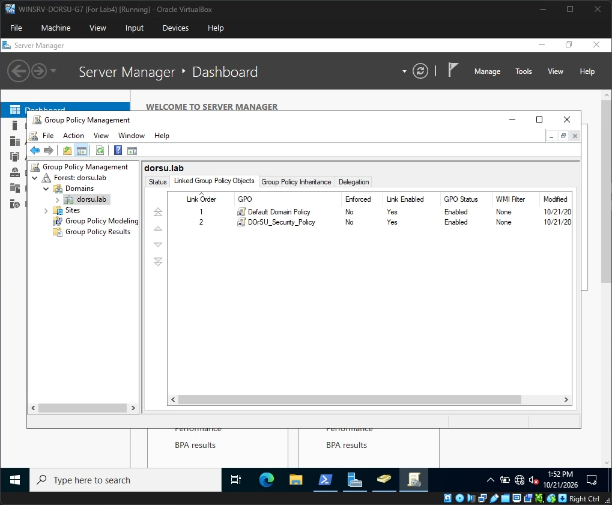

Configure:

```text
Computer Configuration
→ Policies
→ Windows Settings
→ Security Settings
→ Account Policies
→ Password Policy
```

Set:

```text
Minimum password length = 8
Maximum password age = 90 days
Password must meet complexity requirements = Enabled
```

**Screenshot 08 — Password Policy settings**

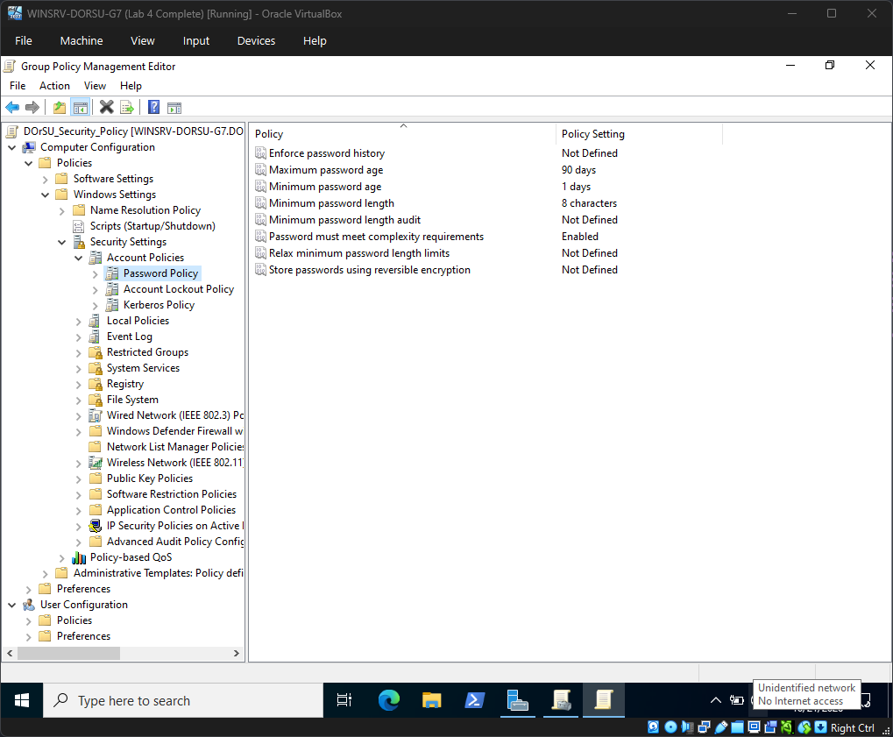

---

## 3.2 Create the Control Panel Restriction GPO

Create a second GPO and link it to:

```text
IT_Department
```

Configure:

```text
User Configuration
→ Policies
→ Administrative Templates
→ Control Panel
→ Prohibit access to Control Panel and PC settings
→ Enabled
```

**Screenshot 09 — Control Panel GPO linked to `IT_Department`**

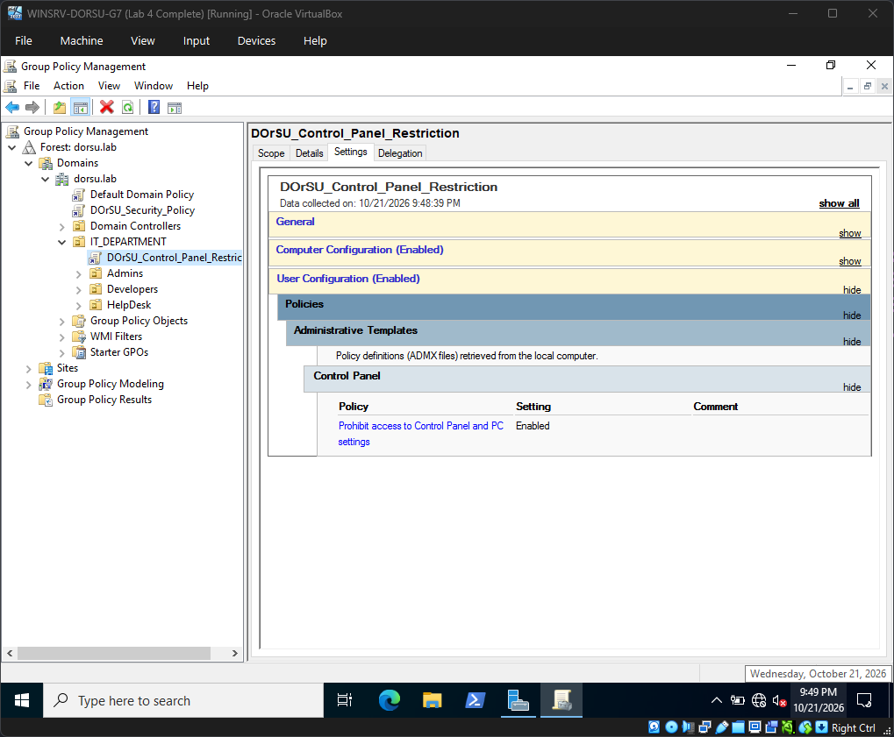

**Screenshot 10 — Control Panel restriction enabled**

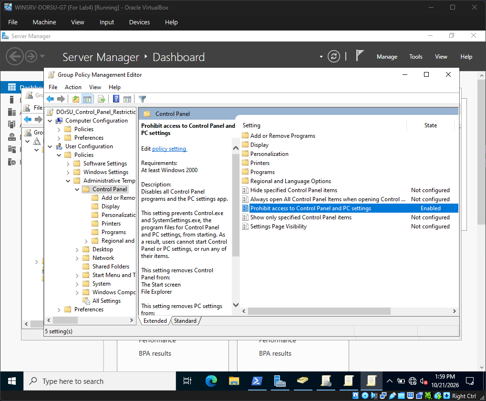

---

## 3.3 Verify Using Group Policy Modeling

Because no client is joined to the domain, use **Group Policy Modeling** rather than a normal user logon test.

In GPMC:

```text
Group Policy Modeling
→ Group Policy Modeling Wizard
```

Use:

```text
User: m.cruz
Computer: the domain controller
```

Verify the report shows the correct policies applied to the correct scopes.

**Screenshot 11 — Group Policy Modeling report for `m.cruz`**

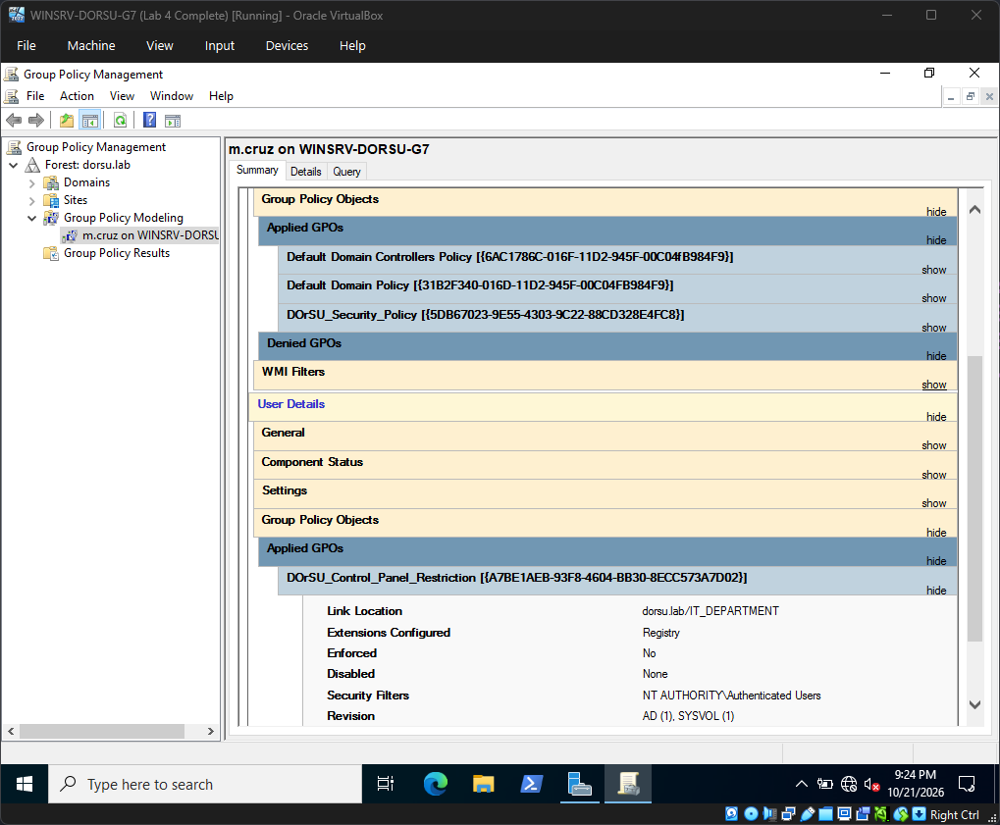

**Record in the worksheet:**

- Password GPO must be linked at the domain root for domain account password policy.
- Per-group password rules require a Fine-Grained Password Policy / Password Settings Object (PSO), not an OU-linked password GPO.
- Compare the lab policy with NIST SP 800-63B-4 as required by the worksheet.

---

# STEP 4 — Member 3: Create Linux Users and Role Groups

Run on Ubuntu Server.

## 4.1 Create the Users

```bash
sudo useradd -m -s /bin/bash m.cruz
sudo useradd -m -s /bin/bash l.tan
```

Set passwords:

```bash
sudo passwd m.cruz
sudo passwd l.tan
```

## 4.2 Create the Role Groups

```bash
sudo groupadd developers
sudo groupadd helpdesk
```

Add users to their groups:

```bash
sudo usermod -aG developers m.cruz
sudo usermod -aG helpdesk l.tan
```

**Screenshot 12 — Linux user and group creation commands**

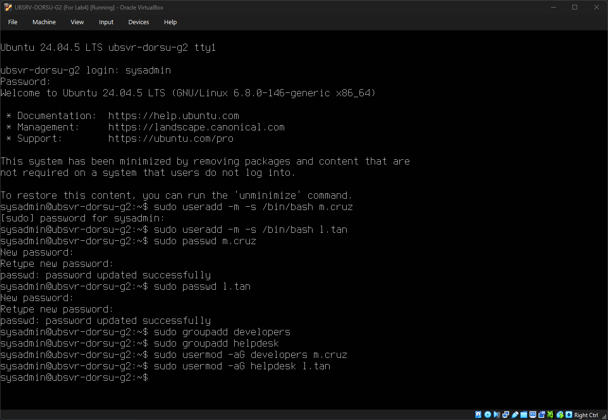

> If the commands produce little or no output, capture the commands and then immediately run the verification commands below in the same terminal.

## 4.3 Verify Membership

```bash
id m.cruz
```

**Screenshot 13 — `id m.cruz` shows `developers` membership**

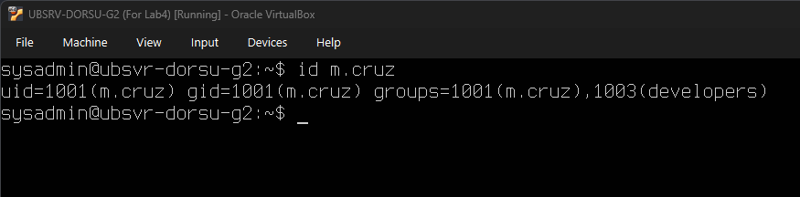

Run:

```bash
id l.tan
```

**Screenshot 14 — `id l.tan` shows `helpdesk` membership**


---

# STEP 5 — Member 3: Configure and Test Linux RBAC with sudoers

## 5.1 Create the sudoers File

Run:

```bash
sudo visudo -f /etc/sudoers.d/lab4
```

Enter exactly one rule per role:

```sudoers
%developers ALL=(ALL) /usr/bin/apt, /usr/bin/systemctl
%helpdesk ALL=(ALL) /usr/bin/cat /var/log/*, /usr/bin/systemctl status *
```

Save and exit.

To display the file for documentation:

```bash
sudo cat /etc/sudoers.d/lab4
```

**Screenshot 15 — `/etc/sudoers.d/lab4` contents**

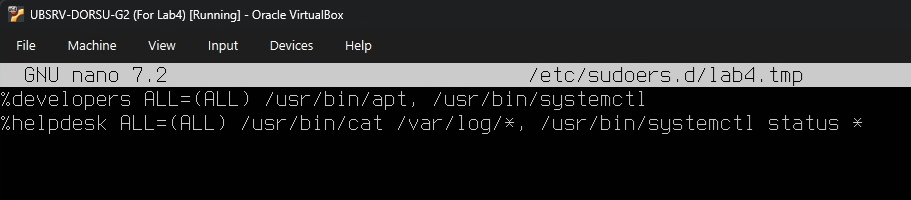

---

## 5.2 Validate the sudoers File and Permissions

Run:

```bash
sudo visudo -cf /etc/sudoers.d/lab4
sudo chmod 440 /etc/sudoers.d/lab4
ls -l /etc/sudoers.d/lab4
```

**Expected validation:**

```text
/etc/sudoers.d/lab4: parsed OK
```

**Expected permissions:**

```text
-r--r-----
```

**Screenshot 16 — sudoers syntax validation and mode `440`**

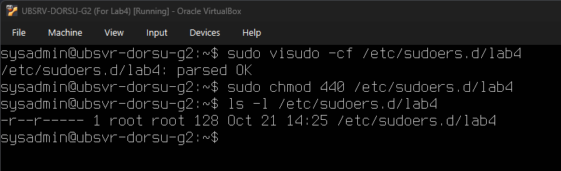

---

## 5.3 Test the Developers Role — Allowed Command

Switch to `m.cruz`:

```bash
su - m.cruz
```

Run:

```bash
sudo apt update
```

This should **PASS**.

**Screenshot 17 — `m.cruz`: `sudo apt update` PASS**

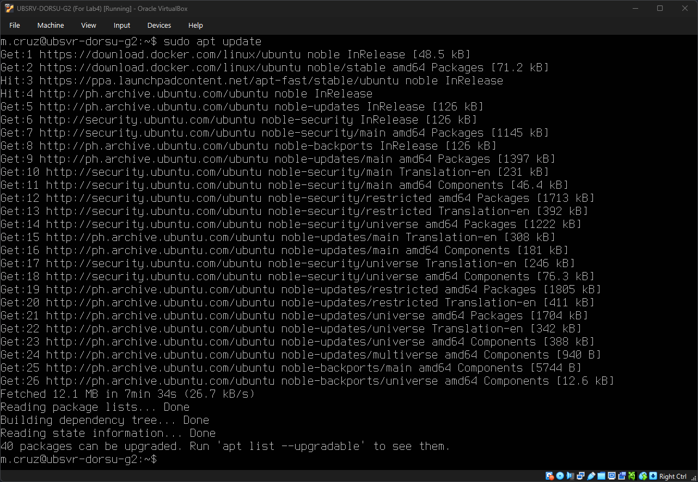

---

## 5.4 Test the Developers Role — Denied Command

As `m.cruz`, run:

```bash
sudo reboot
```

This should be **DENIED** by sudo.

**Screenshot 18 — `m.cruz`: `sudo reboot` DENIED**

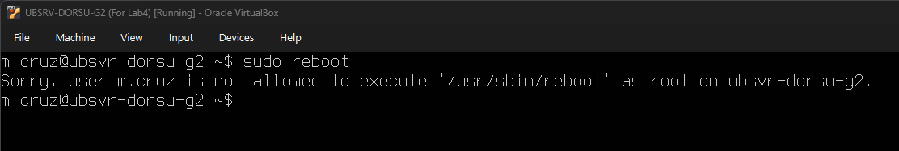

> Make sure the denial message is visible. Do not run an unrestricted root shell merely to force the test.

---

## 5.5 Test the HelpDesk Role — Allowed Command

Switch to `l.tan`:

```bash
su - l.tan
```

Run:

```bash
sudo systemctl status ssh
```

This should **PASS**.

**Screenshot 19 — `l.tan`: `sudo systemctl status ssh` PASS**

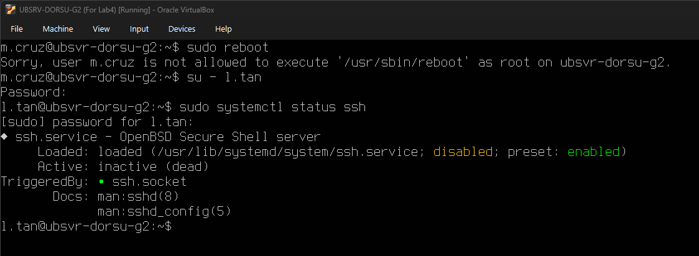

If the command opens a pager, press:

```text
q
```

to return to the shell.

---

## 5.6 Test the HelpDesk Role — Denied Command

As `l.tan`, run:

```bash
sudo systemctl stop ssh
```

This should be **DENIED**.

**Screenshot 20 — `l.tan`: `sudo systemctl stop ssh` DENIED**

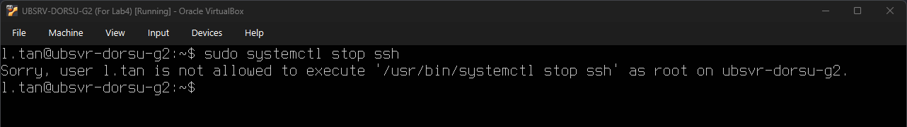

### Required risk notes for the worksheet

Record that the lab sudoers rules are intentionally broad and weaker than production rules because:

- `/usr/bin/cat /var/log/*` uses a wildcard that can match unsafe path traversal arguments.
- Unrestricted `apt` can execute root-level hooks or other privileged operations.
- Broad `systemctl` access can effectively become root-equivalent.
- `systemctl status` may invoke a pager running with privilege, which is dangerous if shell escapes are allowed.
- Production sudoers rules should restrict exact subcommands and arguments.

---

# STEP 6 — Member 4: Install and Configure auditd

Return to the normal administrator account before continuing.

## 6.1 Install `auditd`

```bash
sudo apt install auditd -y
sudo systemctl enable --now auditd
```

Because the minimized Ubuntu build may not contain `/var/log/auth.log`, install `rsyslog` if necessary:

```bash
sudo apt install rsyslog -y
sudo systemctl enable --now rsyslog
```

Verify:

```bash
systemctl status auditd --no-pager
systemctl status rsyslog --no-pager
ls -l /var/log/auth.log
```

**Screenshot 21 — auditd/rsyslog installed and active**

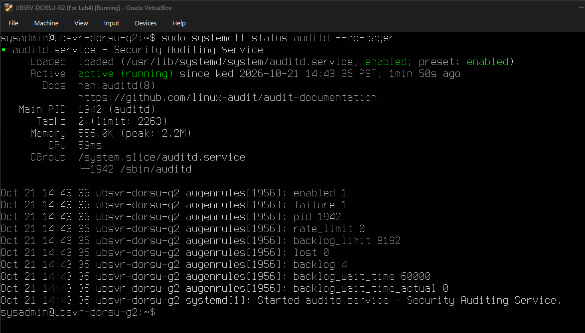

---

## 6.2 Create Persistent auditd Rules

Edit:

```bash
sudo nano /etc/audit/rules.d/lab4.rules
```

Add:

```text
-w /etc/passwd -p wa -k identity
-w /etc/group -p wa -k identity
-w /etc/sudoers -p wa -k privilege
-w /etc/sudoers.d/ -p wa -k privilege
-w /var/log/auth.log -p wa -k logins
```

Optional command auditing rule from the laboratory instructions:

```text
-a always,exit -F arch=b64 -S execve -F auid>=1000 -F auid!=unset -k commands
```

Display the file:

```bash
sudo cat /etc/audit/rules.d/lab4.rules
```

**Screenshot 22 — `/etc/audit/rules.d/lab4.rules`**

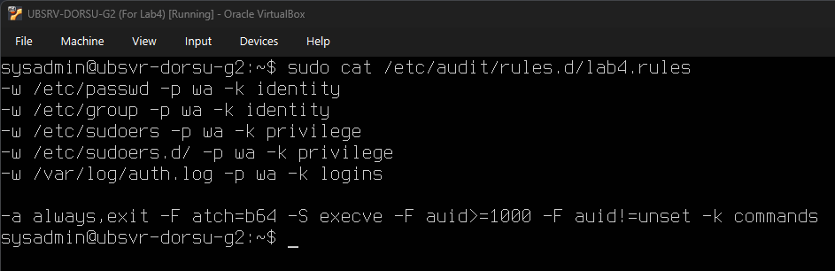

---

## 6.3 Load and Verify the Rules

```bash
sudo augenrules --load
sudo auditctl -l
```

**Screenshot 23 — Loaded audit rules**

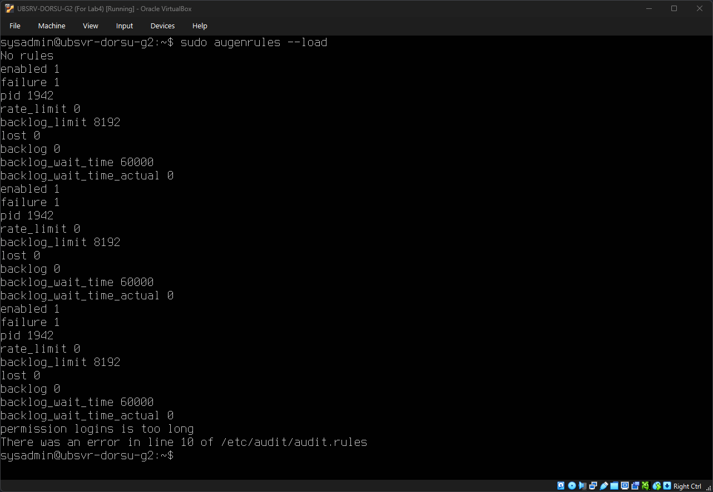 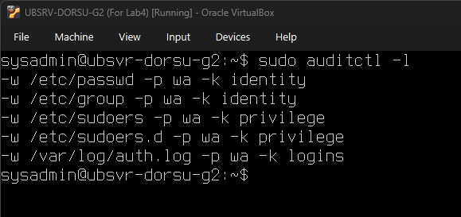

**What must be visible:**

- `identity` watches
- `privilege` watches
- `logins` watch
- Optional `commands` rule if your group added it

---

# STEP 7 — Member 4: Generate and Retrieve Audit Events

> Important: Generate each event **before** running its corresponding `ausearch` command.

## 7.1 `/etc/passwd` Identity Event

Generate the event:

```bash
sudo touch /etc/passwd
```

Search:

```bash
sudo ausearch -k identity | tail -5
```

**Screenshot 24 — `/etc/passwd` audit event using key `identity`**

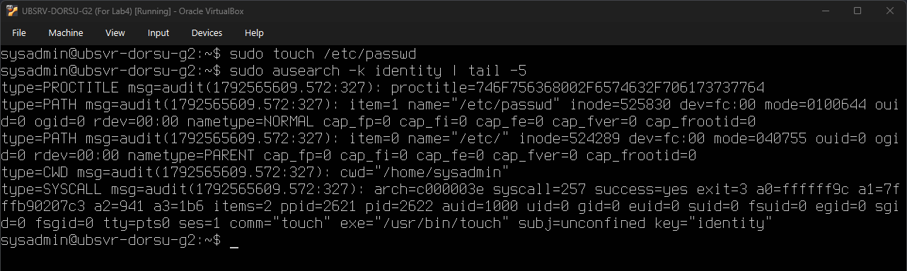

---

## 7.2 `/etc/group` Identity Event

Generate the event:

```bash
sudo groupadd auditest
```

Search again:

```bash
sudo ausearch -k identity | tail -5
```

**Screenshot 25 — `/etc/group` audit event using key `identity`**

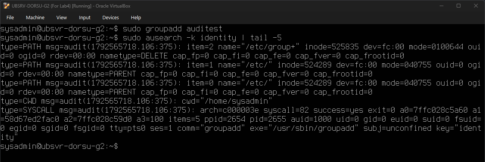

> If `auditest` already exists, use a different temporary group name and record that name in the worksheet.

---

## 7.3 sudoers Privilege Event

Edit the sudoers file safely:

```bash
sudo visudo -f /etc/sudoers.d/lab4
```

Add a harmless comment, for example:

```text
# reviewed by Member 4
```

Save and exit.

Search:

```bash
sudo ausearch -k privilege | tail -5
```

**Screenshot 26 — sudoers change found under key `privilege`**

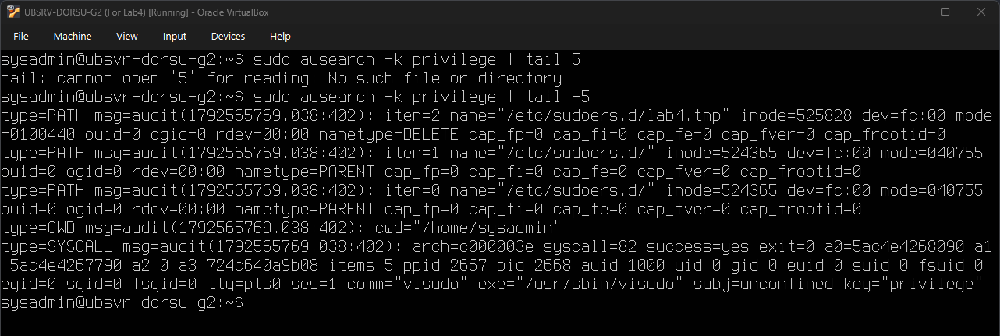

---

## 7.4 Generate a Denied sudo Command

Switch to `l.tan`:

```bash
su - l.tan
```

Attempt:

```bash
sudo systemctl stop ssh
```

The command should be denied.

Return to an administrative shell if necessary, then search:

```bash
sudo ausearch -m USER_CMD -ts recent
```

Look for the failed sudo command and:

```text
res=failed
```

**Screenshot 27 — denied sudo command in `ausearch`**

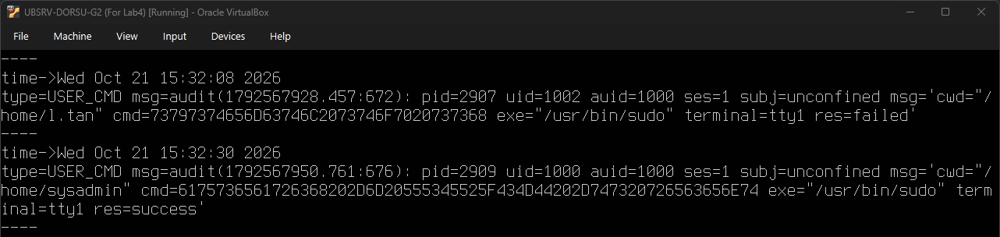

---

## 7.5 Verify the Same Denial in the sudo Journal

Run:

```bash
sudo journalctl _COMM=sudo --since "10 min ago"
```

**Screenshot 28 — sudo denial in the journal**

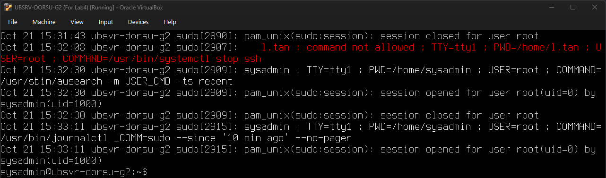

---

## 7.6 Verify the Authentication Log Watch

Run:

```bash
sudo ausearch -k logins | tail -5
```

**Screenshot 29 — `auth.log` activity under key `logins`**

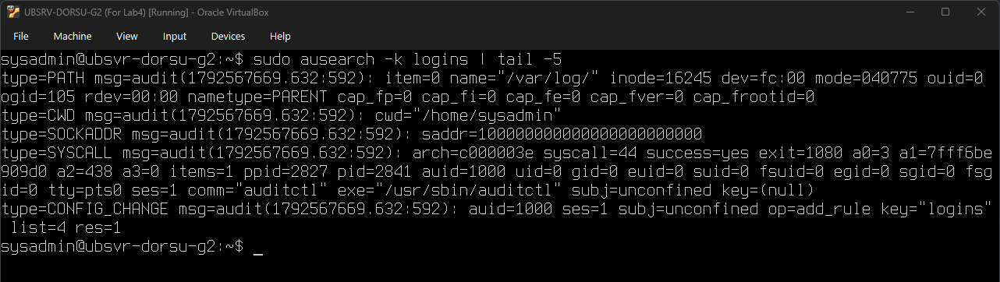

---
