# ITP 141 — Laboratory Exercise 5 Screenshot Documentation

**Lab 5:** LVM Storage Management, Samba File Sharing, and `rsync` Backup Automation**Platforms:** Ubuntu Server 24.04 LTS + Windows Server 2022**Purpose:** Store and label screenshots for every major Lab 5 step, including executed commands, configuration files, verification results, restore evidence, and required worksheet evidence.

> **Screenshot rule:** Capture the **command/configuration and its result in the same screenshot whenever possible**. Do not crop away the terminal prompt, File Explorer path, service status, mount path, or other context needed to verify what was done.
>
> **Recommended folder:** Save images in a `screenshots/` folder beside this Markdown file using the filenames shown below.

---

# STEP 1 — Add and Confirm the Second Virtual Disk

With the Ubuntu guest powered off:

```text
VirtualBox
→ UBSRV-DORSU
→ Settings
→ Storage
→ Add new SATA disk
```

Create:

```text
Size: 20 GB
Type: VDI
Allocation: Dynamically allocated
```

Boot Ubuntu Server.

## 1.1 Confirm the New Disk

Run:

```bash
lsblk
```

The new disk should normally appear as:

```text
/dev/sdb
```

> Disk names depend on the VM configuration. Confirm the actual device before running any LVM command. Using the wrong disk can destroy existing data.

**Screenshot 01 — `lsblk` showing the new 20 GB disk**

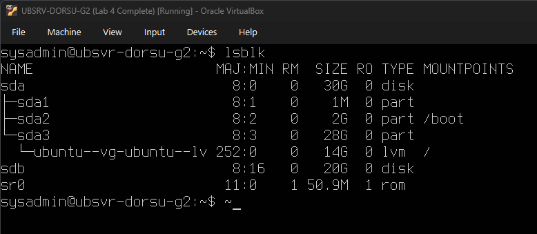

**What must be visible:**

- Existing OS disk
- New approximately 20 GB disk
- Expected device name such as `sdb`
- New disk has no existing mount point

---

# STEP 2 — Member 1: Build the LVM Stack

## 2.1 Create the Physical Volume

Run:

```bash
sudo pvcreate /dev/sdb
sudo pvs
```

**Screenshot 02 — Physical volume created**

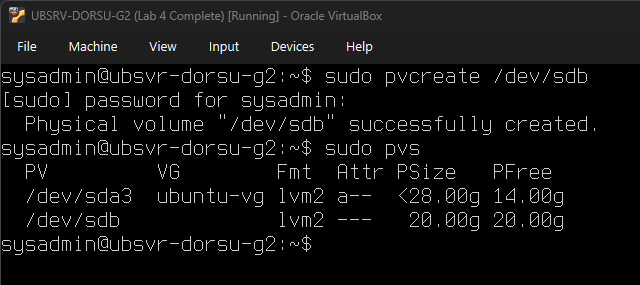

**What must be visible:**

- Successful `pvcreate`
- `/dev/sdb`
- PV size
- Free PV space

---

## 2.2 Create the Volume Group

Run:

```bash
sudo vgcreate lab5_vg /dev/sdb
sudo vgs
```

Record the free space shown by `vgs`. Step 8 depends on this unused capacity.

**Screenshot 03 — `lab5_vg` created with free space remaining**

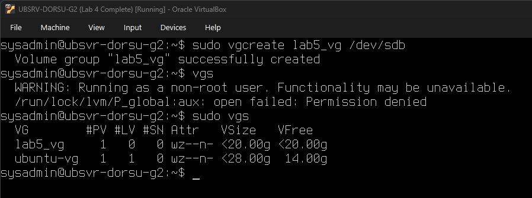

**What must be visible:**

- Volume group name `lab5_vg`
- One physical volume
- Volume group size
- `VFree` showing unused space

---

## 2.3 Create the Logical Volumes

Run:

```bash
sudo lvcreate -L 2G -n data_lv lab5_vg
sudo lvcreate -L 1G -n backup_lv lab5_vg
sudo lvs
```

**Screenshot 04 — `data_lv` and `backup_lv` created**

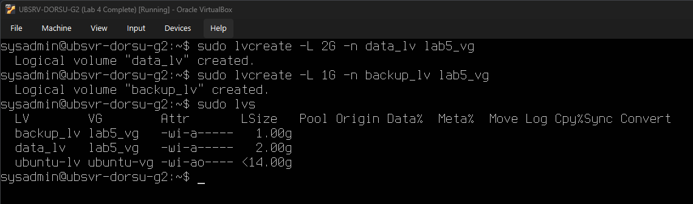

**What must be visible:**

- `data_lv`
- `backup_lv`
- Volume group `lab5_vg`
- `data_lv` approximately `2.00g`
- `backup_lv` approximately `1.00g`

---

# STEP 3 — Member 1: Format, Mount, and Configure Persistent Mounts

## 3.1 Format Both Logical Volumes

Run:

```bash
sudo mkfs.ext4 /dev/lab5_vg/data_lv
sudo mkfs.ext4 /dev/lab5_vg/backup_lv
```

**Screenshot 05 — Both logical volumes formatted as ext4**

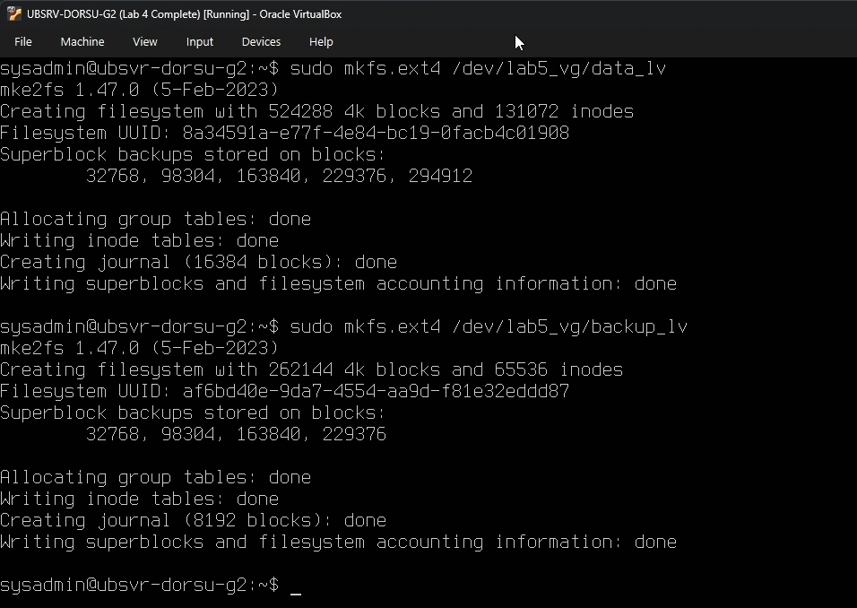

**What must be visible:**

- Formatting command for `data_lv`
- Formatting command for `backup_lv`
- Successful ext4 filesystem creation for both

---

## 3.2 Create Mount Points and Mount the Volumes

Run:

```bash
sudo mkdir -p /mnt/data /mnt/backup

sudo mount /dev/lab5_vg/data_lv /mnt/data
sudo mount /dev/lab5_vg/backup_lv /mnt/backup

df -h
```

**Screenshot 06 — `/mnt/data` and `/mnt/backup` mounted**

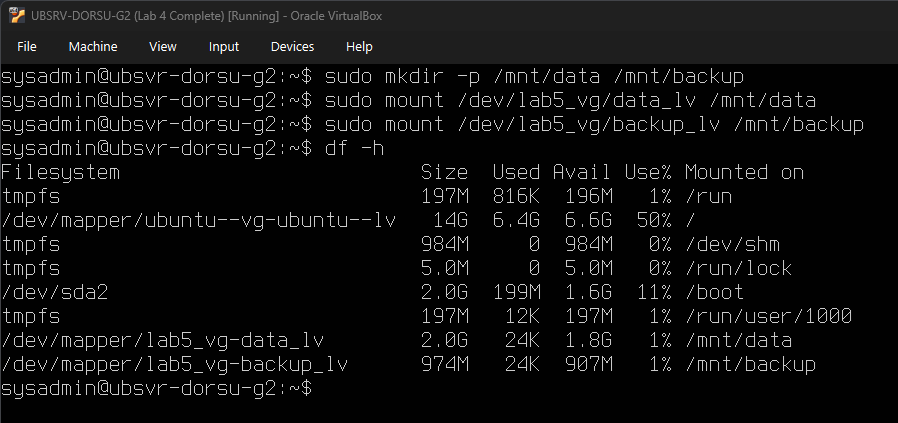

**What must be visible:**

- `data_lv` mounted at `/mnt/data`
- `backup_lv` mounted at `/mnt/backup`
- Filesystem sizes in `df -h`

---

## 3.3 Read the Filesystem UUIDs

Run:

```bash
sudo blkid
```

Locate the UUID values for:

```text
/dev/mapper/lab5_vg-data_lv
/dev/mapper/lab5_vg-backup_lv
```

**Screenshot 07 — UUIDs for both logical volumes**

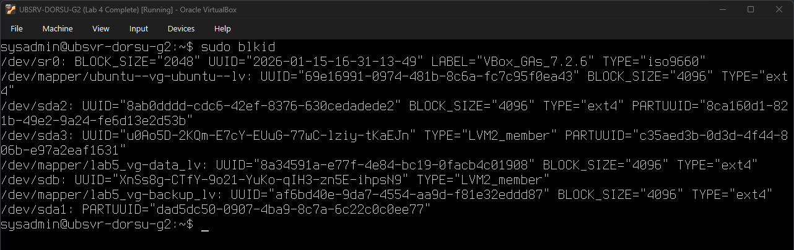

**What must be visible:**

- UUID for `data_lv`
- UUID for `backup_lv`
- `TYPE="ext4"`

---

## 3.4 Add UUID-Based `/etc/fstab` Entries

Open:

```bash
sudo nano /etc/fstab
```

Add one entry for each filesystem in this form:

```text
UUID=<data_uuid>   /mnt/data     ext4   defaults   0   2
UUID=<backup_uuid> /mnt/backup   ext4   defaults   0   2
```

Use the **actual UUID values from your machine**.

To display the entries for documentation, run:

```bash
tail -n 5 /etc/fstab
```

**Screenshot 08 — UUID-based `/etc/fstab` entries**

**What must be visible:**

- UUID entry for `/mnt/data`
- UUID entry for `/mnt/backup`
- `ext4`
- `defaults`
- `0 2`

---

## 3.5 Reload and Verify `/etc/fstab`

Run:

```bash
sudo systemctl daemon-reload
sudo mount -a
df -h
```

`mount -a` must complete without errors.

**Screenshot 09 — Persistent mounts verified**

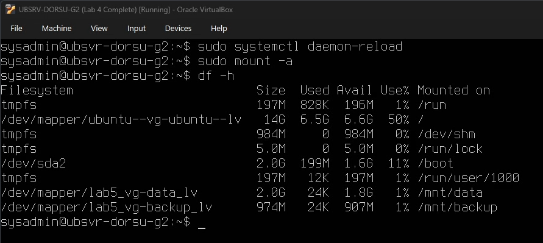

**What must be visible:**

- `mount -a` completes without an error
- `/mnt/data`
- `/mnt/backup`
- Both remain mounted

> A malformed `/etc/fstab` entry can prevent normal boot, so verify it before continuing.

---

# STEP 4 — Member 2: Configure Samba

## 4.1 Install Samba and Back Up the Configuration

Run:

```bash
sudo apt install samba -y
sudo cp /etc/samba/smb.conf /etc/samba/smb.conf.bak
```

The worksheet requires the configuration backup before editing `smb.conf`.

---

## 4.2 Add the `[DataShare]` Share

Open:

```bash
sudo nano /etc/samba/smb.conf
```

Add:

```ini
[DataShare]
    path = /mnt/data
    browseable = yes
    read only = no
    valid users = @developers
```

Display the relevant section for documentation:

```bash
grep -A4 '^\[DataShare\]' /etc/samba/smb.conf
```

**Screenshot 10 — `[DataShare]` Samba configuration**

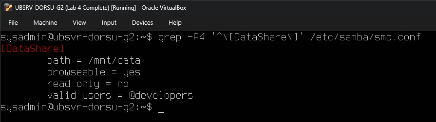

**What must be visible:**

- `[DataShare]`
- `path = /mnt/data`
- `browseable = yes`
- `read only = no`
- `valid users = @developers`

This same stanza belongs in **Worksheet Section 4**.

---

## 4.3 Configure Share Ownership and Permissions

Run:

```bash
sudo chown -R m.cruz:developers /mnt/data
sudo chmod 2770 /mnt/data
ls -ld /mnt/data
```

**Screenshot 11 — `/mnt/data` ownership and permissions**

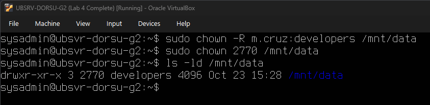

**What must be visible:**

- Owner `m.cruz`
- Group `developers`
- Permission mode equivalent to `2770`
- Setgid bit visible as `s` in the group execute position

Expected style:

```text
drwxrws---
```

---

## 4.4 Add the Samba Password for `m.cruz`

Run:

```bash
sudo smbpasswd -a m.cruz
```

Enter the Samba password when prompted.

**Screenshot 12 — `m.cruz` added to Samba**

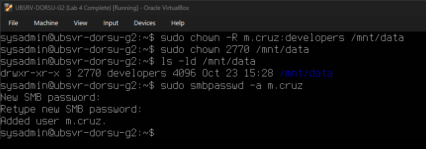

**What must be visible:**

- `smbpasswd -a m.cruz`
- Successful user-addition message

> Do **not** expose the password in the screenshot.

---

## 4.5 Validate and Restart Samba

Run:

```bash
testparm
sudo systemctl restart smbd nmbd
sudo systemctl status smbd --no-pager
```

**Screenshot 13 — Samba configuration validated and `smbd` running**

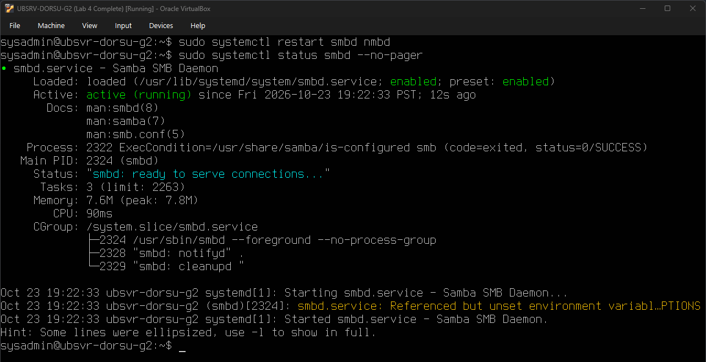

**What must be visible:**

- Samba configuration loads successfully
- `smbd.service`
- `Active: active (running)`

---

# STEP 5 — Member 2: Test the Samba Share from Windows

## 5.1 Open the Share from Windows Server 2022

In File Explorer, enter:

```text
\\192.168.10.12\DataShare
```

Sign in as:

```text
m.cruz
```

If Windows tries the domain account automatically:

```text
More choices
→ Use a different account
```

Use the Ubuntu server as the account authority:

```text
ubsrv-dorsu-[GroupID]\m.cruz
```

Use the Samba password created with `smbpasswd`.

Create:

```text
DOrSU_Lab5_Test.txt
```

**Screenshot 14 — Windows access to `DataShare`**

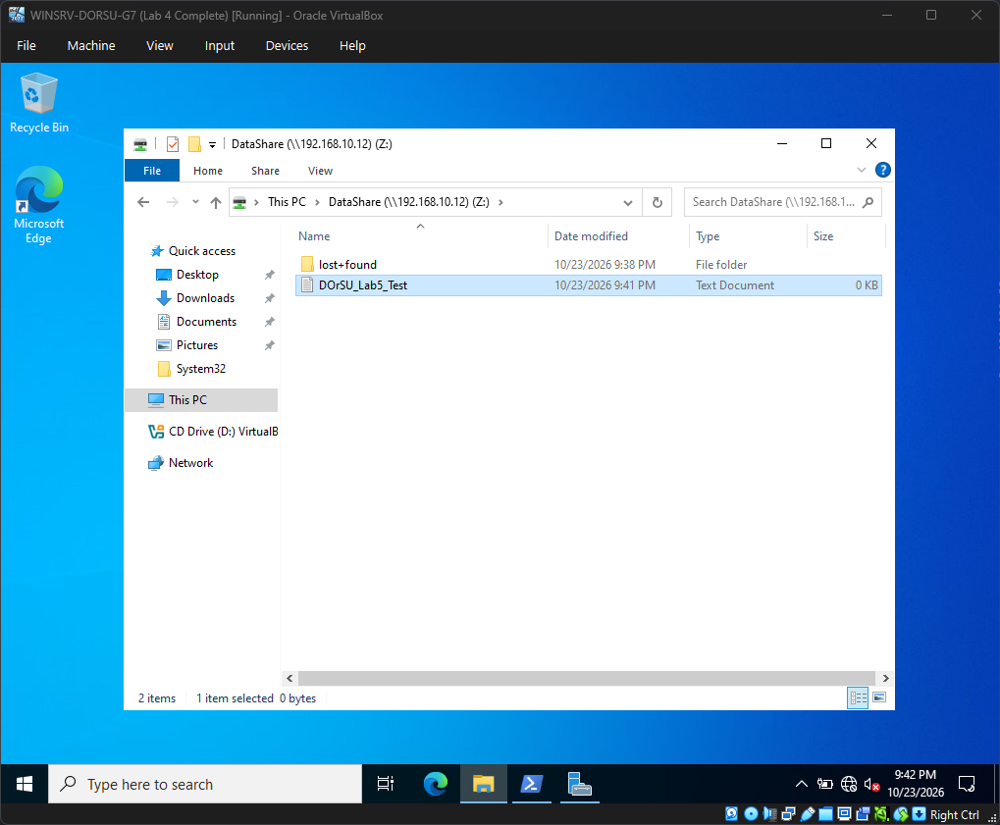

**What must be visible:**

- File Explorer
- `DataShare`
- Network path if possible
- `DOrSU_Lab5_Test.txt`

---

## 5.2 Verify the File on Ubuntu

Return to Ubuntu and run:

```bash
ls -l /mnt/data/
```

**Screenshot 15 — Test-file ownership verified on Ubuntu**

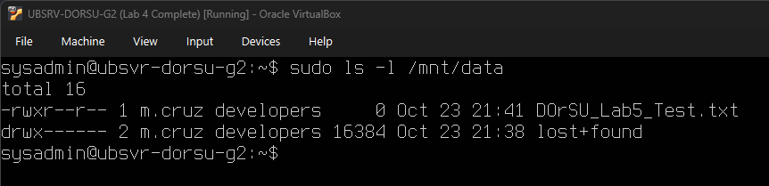

**What must be visible:**

- `DOrSU_Lab5_Test.txt`
- File owner is the Laboratory Exercise 4 account rather than `root`
- Appropriate group ownership

> If Laboratory Exercise 6 UFW rules are already active and SMB is blocked, the worksheet specifies reopening Samba access from the laboratory subnet with:
>
> ```bash
> sudo ufw allow from 192.168.10.0/24 to any app Samba
> ```

---

# STEP 6 — Member 3: Complete the Backup Strategy Calculations

Use the worksheet convention:

```text
Dataset size = 20 GB
Daily change = 200 MB
1 GB = 1000 MB
Period = 4 weeks
```

## 6.1 Full Backup Weekly Only

```text
4 × 20 GB = 80 GB
```

**4-week total:**

```text
80 GB
```

---

## 6.2 Full Weekly + Incremental Daily

There are six daily incrementals per week:

```text
6 × 4 = 24 incremental backups
24 × 200 MB = 4800 MB
4800 MB = 4.8 GB
```

Add the four weekly full backups:

```text
80 GB + 4.8 GB = 84.8 GB
```

**4-week total:**

```text
84.8 GB
```

---

## 6.3 Full Weekly + Differential Daily

Each week:

```text
200 + 400 + 600 + 800 + 1000 + 1200 MB
= 4200 MB
= 4.2 GB
```

Across four weeks:

```text
4 × 4.2 GB = 16.8 GB
```

Add the weekly full backups:

```text
80 GB + 16.8 GB = 96.8 GB
```

**4-week total:**

```text
96.8 GB
```

---

## 6.4 Complete Worksheet Section 5

Suggested entries:

| Strategy                         | Frequency                           | 4-Week Total Storage | Restore Speed           | Best Used For                               | Worst Drawback                                                  |
| -------------------------------- | ----------------------------------- | -------------------: | ----------------------- | ------------------------------------------- | --------------------------------------------------------------- |
| Full Backup Weekly Only          | One full backup each week           |            `80 GB` | Fast                    | Simple restore process                      | Up to one week of changes may be missing                        |
| Full Weekly + Incremental Daily  | Weekly full + Mon–Sat incremental  |          `84.8 GB` | Slowest                 | Lower storage use with daily restore points | Restore requires the full backup plus the required incrementals |
| Full Weekly + Differential Daily | Weekly full + Mon–Sat differential |          `96.8 GB` | Faster than incremental | Faster daily restore with fewer backup sets | Differential backups grow each day                              |

The worksheet explicitly says the deciding constraint for the recommendation is:

```text
Restore time rather than disk space
```

A defensible recommendation is:

```text
Full weekly + differential daily
```

because restoring normally requires only the latest full backup and the latest differential backup.

**Screenshot 16 — Completed backup-strategy calculation table**


**What must be visible:**

- All three strategies
- `80 GB`
- `84.8 GB`
- `96.8 GB`
- Restore-speed comparison
- Best use
- Worst drawback

---

# STEP 7 — Member 4: Create the rsync Backup and Demonstrate Restore

## 7.1 Give `sysadmin` Access to the Backup Destination

Run:

```bash
sudo chown sysadmin:sysadmin /mnt/backup
```

The script runs as `sysadmin`, so `/mnt/backup` must be writable by that account.

---

## 7.2 Create `/home/sysadmin/lab5_backup.sh`

Open:

```bash
nano /home/sysadmin/lab5_backup.sh
```

Enter:

```bash
#!/bin/bash
set -Eeuo pipefail

LOG=/home/sysadmin/lab5_backup.log

trap 'echo "BACKUP FAILED $(date -Is)" >> "$LOG"; exit 1' ERR

DEST=/mnt/backup/backup_$(date +%Y%m%d_%H%M%S)

mkdir -p "$DEST"

rsync -a --stats /mnt/data/ "$DEST"/ >> "$LOG" 2>&1

echo "Completed: $DEST at $(date -Is)" >> "$LOG"
```

Make it executable:

```bash
chmod +x /home/sysadmin/lab5_backup.sh
```

Display the script:

```bash
cat /home/sysadmin/lab5_backup.sh
```

**Screenshot 17 — `lab5_backup.sh` contents**

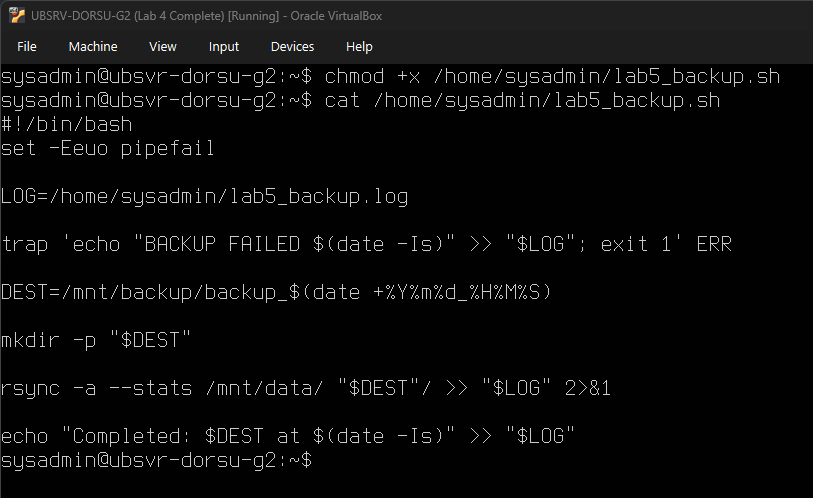

**What must be visible:**

- `set -Eeuo pipefail`
- `LOG=/home/sysadmin/lab5_backup.log`
- `trap ... ERR`
- Timestamped `DEST`
- `mkdir -p "$DEST"`
- `rsync -a --stats`
- Completion log line

> The worksheet intentionally omits `-z` because this is a local copy and compression would waste CPU time. It also omits `--progress` because progress output is unsuitable for a clean automated log.

---

## 7.3 Run the Backup and Check the Log

Run:

```bash
/home/sysadmin/lab5_backup.sh
cat /home/sysadmin/lab5_backup.log
ls -l /mnt/backup/
```

**Screenshot 18 — Successful rsync backup and log**

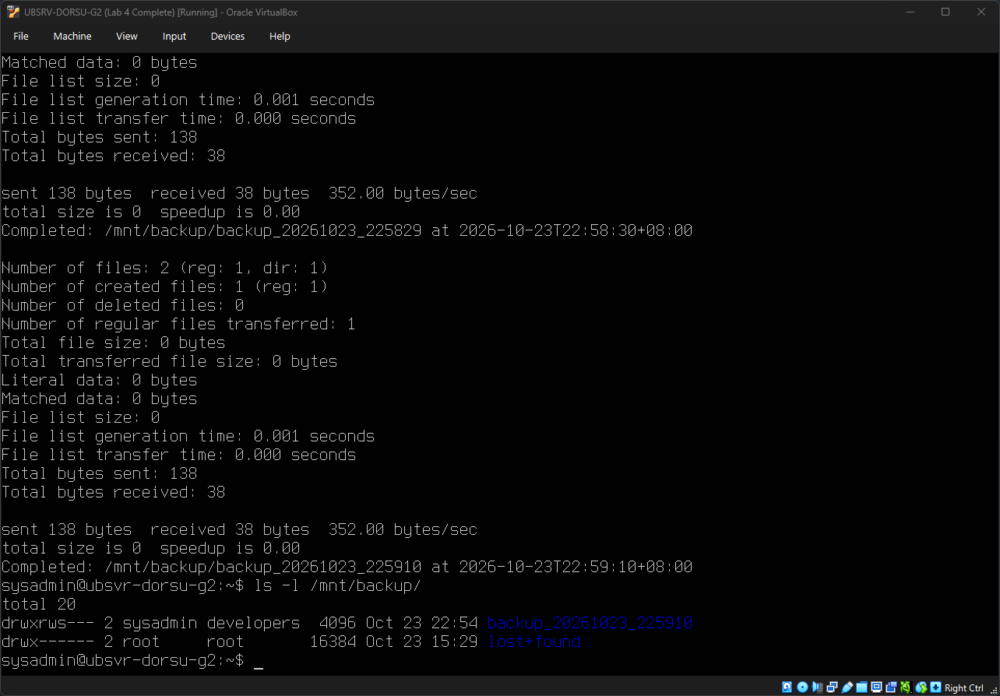

**What must be visible:**

- rsync statistics or logged output
- `Completed:`
- Timestamped backup path such as `backup_YYYYMMDD_HHMMSS`
- Backup directory exists under `/mnt/backup`

This belongs in **Worksheet Section 6**.

---

## 7.4 Delete and Restore the Test File

First identify the timestamped backup directory:

```bash
ls -l /mnt/backup/
```

Delete:

```bash
rm /mnt/data/DOrSU_Lab5_Test.txt
```

Confirm it is gone:

```bash
ls -l /mnt/data/
```

Restore it from the timestamped directory:

```bash
cp /mnt/backup/backup_YYYYMMDD_HHMMSS/DOrSU_Lab5_Test.txt /mnt/data/
```

Replace `backup_YYYYMMDD_HHMMSS` with the **actual directory name** created by the script.

Verify:

```bash
ls -l /mnt/data/
```

**Screenshot 19 — `DOrSU_Lab5_Test.txt` successfully restored**

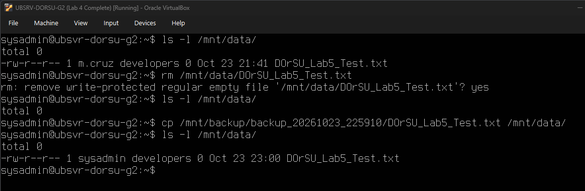

**What must be visible:**

- Restored file name
- `/mnt/data`
- Evidence that the restored file exists again

> The laboratory emphasizes that a backup should be proven by a restore test, not merely by showing that copied files exist.

---

# STEP 8 — Member 4: Schedule the Backup and Extend `data_lv` Online

## 8.1 Add the Cron Schedule

Open:

```bash
crontab -e
```

Add:

```cron
0 23 * * * /bin/bash /home/sysadmin/lab5_backup.sh
```

Verify:

```bash
crontab -l
```

**Screenshot 20 — Daily 11:00 PM backup cron entry**

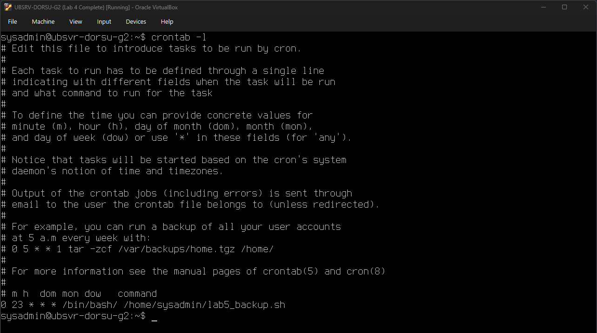

**What must be visible:**

```text
0 23 * * * /bin/bash /home/sysadmin/lab5_backup.sh
```

---

## 8.2 Confirm Free Space Before Extending the LV

Run:

```bash
sudo vgs
```

**Screenshot 21 — Free extents available in `lab5_vg`**

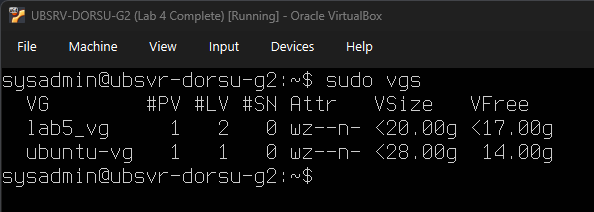

**What must be visible:**

- `lab5_vg`
- `VFree`
- At least 500 MB available

---

## 8.3 Record `df -h` Before Extension

Run:

```bash
df -h
```

**Screenshot 22 — `/mnt/data` before `lvextend`**

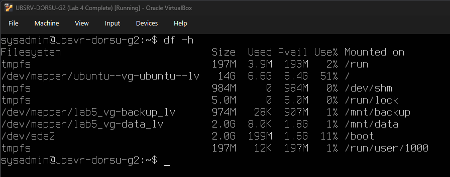

**What must be visible:**

- `/mnt/data`
- Current filesystem size
- Filesystem is mounted

---

## 8.4 Extend the Logical Volume

Run:

```bash
sudo lvextend -L +500M /dev/lab5_vg/data_lv
```

Then expand the ext4 filesystem:

```bash
sudo resize2fs /dev/lab5_vg/data_lv
```

**Screenshot 23 — `lvextend` and `resize2fs` completed online**

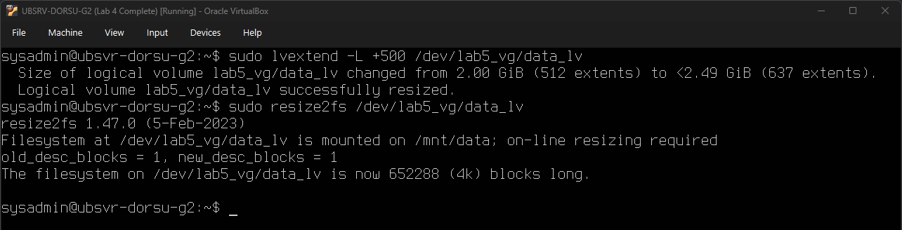

**What must be visible:**

- Successful `lvextend`
- `+500M`
- `/dev/lab5_vg/data_lv`
- Successful `resize2fs`

The mount should **not** be taken offline.

### Why the order matters

```text
lvextend
→ enlarges the logical block device

resize2fs
→ enlarges the ext4 filesystem to use the new block space
```

Running `resize2fs` first cannot enlarge the filesystem into space the logical volume does not yet provide.

> The worksheet notes that `lvextend -r -L +500M ...` could do both steps automatically, but this lab requires the two commands separately so that each layer is visible.

---

## 8.5 Record `df -h` After Extension

Run:

```bash
df -h
```

**Screenshot 24 — `/mnt/data` after online extension**

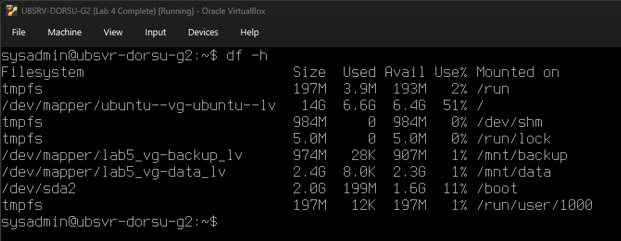

**What must be visible:**

- `/mnt/data`
- Increased filesystem size
- Filesystem is still mounted

Use Screenshots 22 and 24 in **Worksheet Section 7**.

---

# STEP 9 — All Members: Complete the Worksheet Tables and Reflection

## 9.1 Complete the LVM Configuration Summary Table

Use your **actual displayed sizes and device paths**.

Expected structure:

| Component                      | Name          |    Size | Device Path                | Mounted At      | File System | fstab Entry |
| ------------------------------ | ------------- | ------: | -------------------------- | --------------- | ----------- | ----------- |
| Physical Volume (PV)           | `/dev/sdb`  |  ~20 GB | `/dev/sdb`               | N/A             | LVM PV      | N/A         |
| Volume Group (VG)              | `lab5_vg`   |  ~20 GB | LVM VG                     | N/A             | LVM         | N/A         |
| Logical Volume: `data_lv`    | `data_lv`   |    2 GB | `/dev/lab5_vg/data_lv`   | `/mnt/data`   | ext4        | Y           |
| Logical Volume: `backup_lv`  | `backup_lv` |    1 GB | `/dev/lab5_vg/backup_lv` | `/mnt/backup` | ext4        | Y           |
| `data_lv` after `lvextend` | `data_lv`   | ~2.5 GB | `/dev/lab5_vg/data_lv`   | `/mnt/data`   | ext4        | Y           |

**Screenshot 25 — Completed LVM Configuration Summary Table**


