# ITP 141 Lab 6 — Screenshot Documentation

**Laboratory Exercise:** CIS Benchmark Hardening, UFW, Fail2ban, Lynis Audit, and HTML Compliance Report**Purpose:** Store and label screenshots for all executed commands and required evidence.

> Replace each placeholder image path with your actual screenshot filename.
> Recommended format: `screenshots/stepX_YY_description.png`

---

# Step 1 — Lynis Baseline and CIS Level 1 Controls

## Screenshot 1.1 — Install Lynis

Run:

```bash
sudo apt install lynis -y
```

**Capture:** Terminal showing Lynis successfully installed.

**Label:** `Figure 1.1 — Lynis installation`

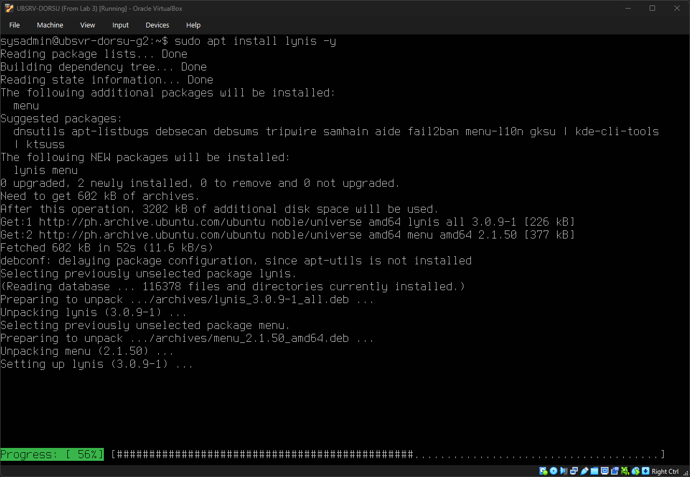

---

## Screenshot 1.2 — Lynis Baseline Audit

Run:

```bash
sudo lynis audit system 2>&1 | sudo tee /var/log/lynis_baseline.log
```

**Capture:** Completed Lynis baseline audit.

**Label:** `Figure 1.2 — Lynis baseline audit`

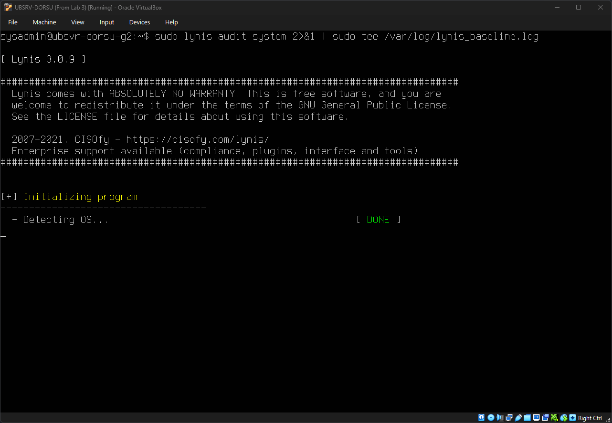

---

## Screenshot 1.3 — Baseline Hardening Index & Lynis Version

Run:

```bash
grep 'Hardening index' /var/log/lynis_baseline.log
lynis show version
```

**Capture:** Baseline hardening index.

**Label:** `Figure 1.3 — Baseline hardening index & Lynis Version`

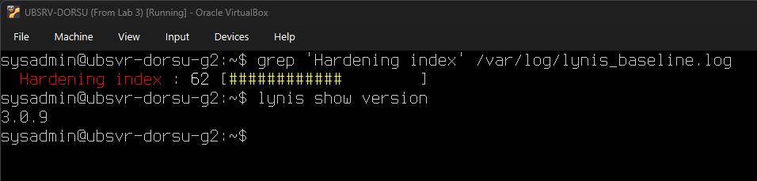

---

## Screenshot 1.5 — Disable cramfs

Run:

```bash
echo -e 'install cramfs /bin/false\nblacklist cramfs' | sudo tee /etc/modprobe.d/cramfs.conf
modprobe -n -v cramfs
```

**Capture:** Configuration creation and verification output.

**Label:** `Figure 1.5 — cramfs disabled`

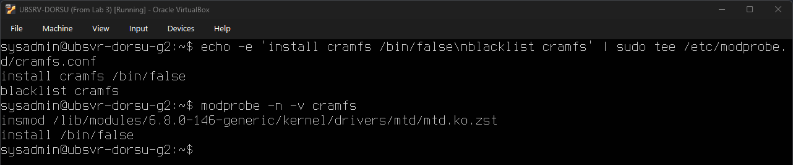

---

## Screenshot 1.6 — Check `/tmp` Mount

Run:

```bash
findmnt /tmp
```

**Capture:** Whether `/tmp` is a separate mount.

**Label:** `Figure 1.6 — /tmp mount verification`

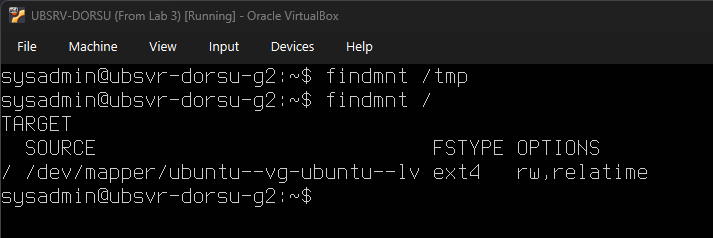

**Note:** If `/tmp` is part of `/`, record that fact instead of forcing `noexec`.

---

## Screenshot 1.7 — SSH CIS Configuration

Create:

```bash
sudo nano /etc/ssh/sshd_config.d/00-cis.conf
```

Add:

```text
PermitRootLogin no
MaxAuthTries 3
```

**Capture:** The contents of `00-cis.conf`.

**Label:** `Figure 1.7 — SSH CIS hardening configuration`

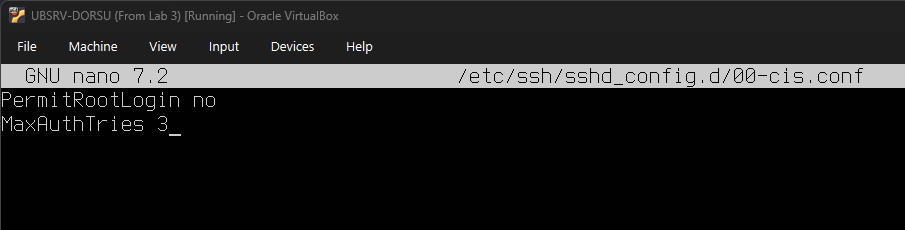

---

## Screenshot 1.8 — Validate SSH Configuration

Run:

```bash
sudo sshd -t
sudo sshd -T | grep -Ei 'permitrootlogin|maxauthtries'
```

Expected values:

```text
permitrootlogin no
maxauthtries 3
```

**Label:** `Figure 1.8 — SSH configuration validation`

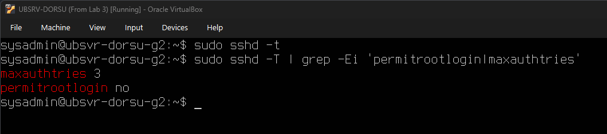

---

## Screenshot 1.9 — Restart SSH

Run:

```bash
sudo systemctl restart ssh
sudo systemctl status ssh
```

**Capture:** SSH service running successfully.

**Label:** `Figure 1.9 — SSH service after hardening`

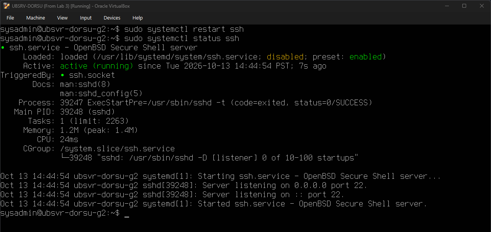

---

## Screenshot 1.10 — Password Quality Package

Run:

```bash
sudo apt install libpam-pwquality -y
```

**Capture:** Successful installation.

**Label:** `Figure 1.10 — libpam-pwquality installation`

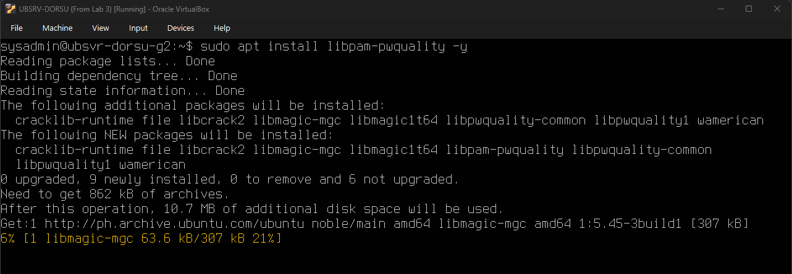

---

## Screenshot 1.11 — Password Quality Configuration

Edit:

```bash
sudo nano /etc/security/pwquality.conf
```

Set:

```text
minlen=12
dcredit=-1
ucredit=-1
```

**Capture:** The configured values.

**Label:** `Figure 1.11 — Password complexity settings`

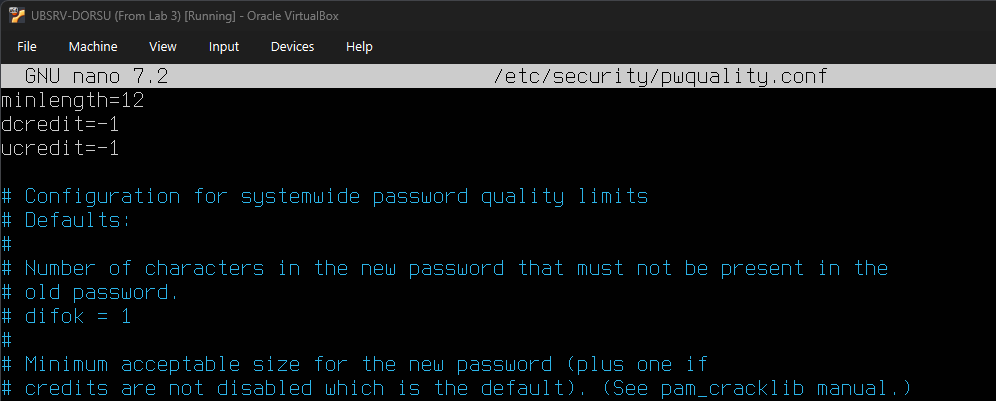

---

## Screenshot 1.12 — Password Ageing Configuration

Edit:

```bash
sudo nano /etc/login.defs
```

Set:

```text
PASS_MAX_DAYS 90
PASS_MIN_DAYS 1
```

Apply to the existing user:

```bash
sudo chage --maxdays 90 --mindays 1 sysadmin
sudo chage -l sysadmin
```

**Capture:** `chage -l` output.

**Label:** `Figure 1.12 — Password ageing policy`

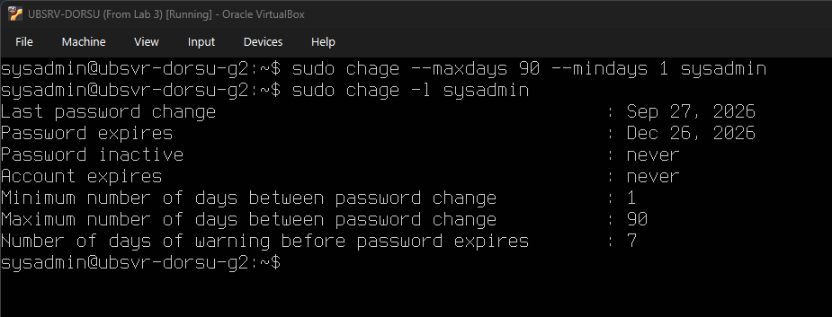

---

## Screenshot 1.13 — `/etc/cron.allow`

Run:

```bash
echo sysadmin | sudo tee /etc/cron.allow
sudo chown root:root /etc/cron.allow
sudo chmod 640 /etc/cron.allow
```

Verify:

```bash
cat /etc/cron.allow
ls -l /etc/cron.allow
```

Then verify cron access as `sysadmin`:

```bash
crontab -l
```

**Label:** `Figure 1.13 — cron.allow configuration`

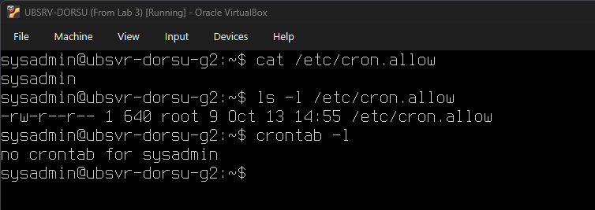

---

## Screenshot 1.14 — Sticky Bit on `/tmp`

Run:

```bash
stat -c %A /tmp
```

**Capture:** Permission output containing `t`.

**Label:** `Figure 1.14 — Sticky bit on /tmp`

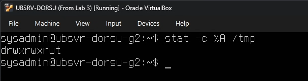

---

## Screenshot 1.15 — Disable USB Storage

Run:

```bash
echo -e 'install usb-storage /bin/false\nblacklist usb-storage' | sudo tee /etc/modprobe.d/usb-storage.conf
```

Verify:

```bash
cat /etc/modprobe.d/usb-storage.conf
```

**Label:** `Figure 1.15 — USB storage disabled`

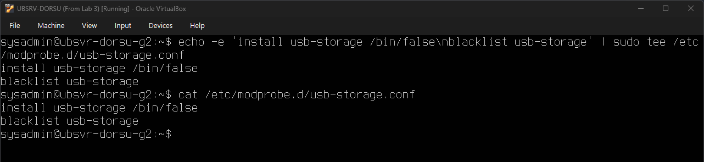

---

# Step 2 — Configure UFW on Ubuntu

Run the SSH allow rule **before enabling UFW**:

```bash
sudo ufw allow from 192.168.10.0/24 to any port 22 proto tcp comment 'SSH from lab LAN'
sudo ufw allow from 192.168.10.0/24 to any port 80 proto tcp comment 'HTTP'
sudo ufw allow from 192.168.10.0/24 to any port 443 proto tcp comment 'HTTPS'
sudo ufw default deny incoming
sudo ufw default allow outgoing
sudo ufw enable
sudo ufw status verbose
```

## Screenshot 2.1 — UFW Rules and Status

**Capture:** `sudo ufw status verbose` showing:

- Default deny incoming
- Default allow outgoing
- TCP 22 allowed from `192.168.10.0/24`
- TCP 80 allowed from `192.168.10.0/24`
- TCP 443 allowed from `192.168.10.0/24`

**Label:** `Figure 2.1 — Ubuntu UFW default-deny configuration`

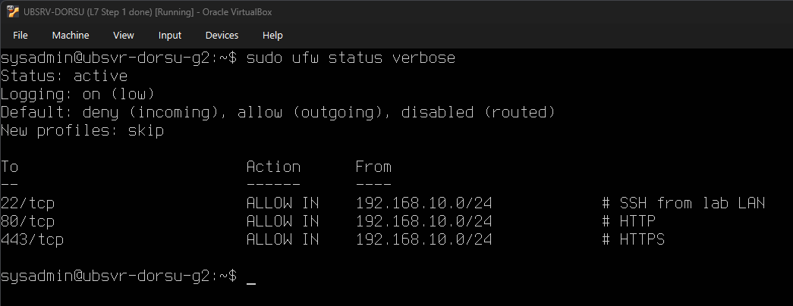

---

## Screenshot 2.2 — UFW Verification from Windows

From the Windows Server guest, test Ubuntu connectivity to the allowed services.

Examples in PowerShell:

```powershell
Test-NetConnection 192.168.10.12 -Port 22
Test-NetConnection 192.168.10.12 -Port 80
Test-NetConnection 192.168.10.12 -Port 443
```

**Capture:** Test results from Windows.

**Label:** `Figure 2.2 — UFW verification from Windows Server`

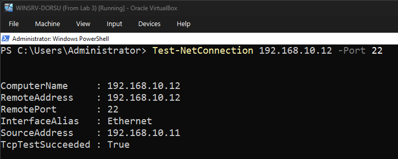


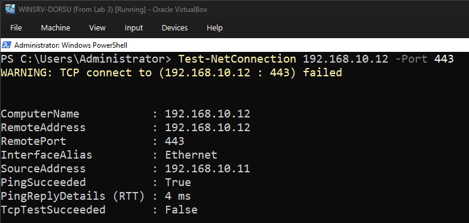

---

# Step 3 — Configure Windows Firewall

Open **PowerShell as Administrator**.

Set the default inbound policy:

```powershell
Set-NetFirewallProfile -Profile Domain,Private,Public -DefaultInboundAction Block
```

Add scoped rules:

```powershell
New-NetFirewallRule -DisplayName "Allow RDP from Lab LAN" -Direction Inbound -Protocol TCP -LocalPort 3389 -RemoteAddress 192.168.10.0/24 -Action Allow
New-NetFirewallRule -DisplayName "Allow HTTP from Lab LAN" -Direction Inbound -Protocol TCP -LocalPort 80 -RemoteAddress 192.168.10.0/24 -Action Allow
New-NetFirewallRule -DisplayName "Allow HTTPS from Lab LAN" -Direction Inbound -Protocol TCP -LocalPort 443 -RemoteAddress 192.168.10.0/24 -Action Allow
```

Also scope or remove the previous any-source port `8080` rule.

## Screenshot 3.1 — Windows Firewall PowerShell Commands

**Capture:** PowerShell showing the commands were executed successfully.

**Label:** `Figure 3.1 — Windows Firewall configuration`

  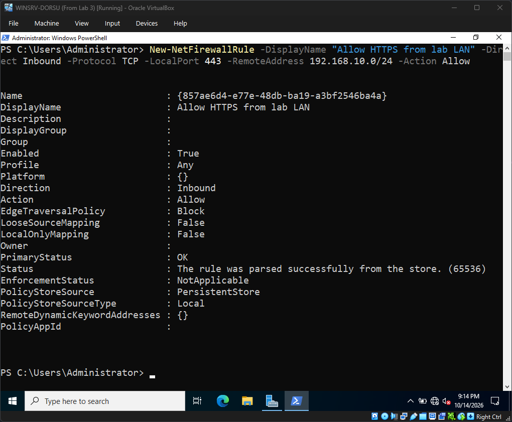

---

## Screenshot 3.2 — Windows Firewall Rule List

Show the created rules in PowerShell or **Windows Defender Firewall with Advanced Security**.

**Label:** `Figure 3.2 — Windows Firewall inbound rules`

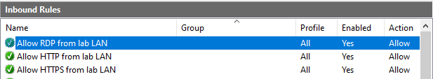

---

## Screenshot 3.3 — Verify Windows Firewall from Ubuntu

From Ubuntu, test the Windows Server IP.

Example:

```bash
nc -zv 192.168.10.11 3389
nc -zv 192.168.10.11 80
nc -zv 192.168.10.11 443
```

**Label:** `Figure 3.3 — Windows Firewall verification from Ubuntu`

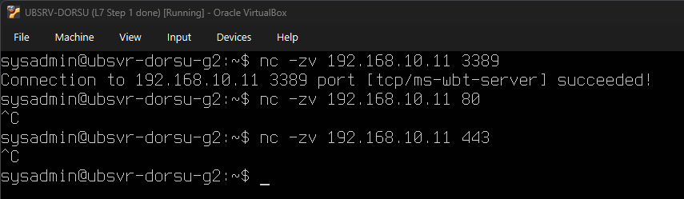

---

# Step 4 — Install and Configure Fail2ban

Install:

```bash
sudo apt install fail2ban -y
```

Create:

```bash
sudo nano /etc/fail2ban/jail.local
```

Add:

```ini
[sshd]
enabled = true
port = ssh
maxretry = 3
bantime = 600
findtime = 300
backend = systemd
```

Start Fail2ban:

```bash
sudo systemctl enable --now fail2ban
sudo fail2ban-client status sshd
```

## Screenshot 4.1 — Fail2ban SSH Jail Configuration

**Capture:** Contents of `/etc/fail2ban/jail.local`.

**Label:** `Figure 4.1 — Fail2ban SSH jail configuration`

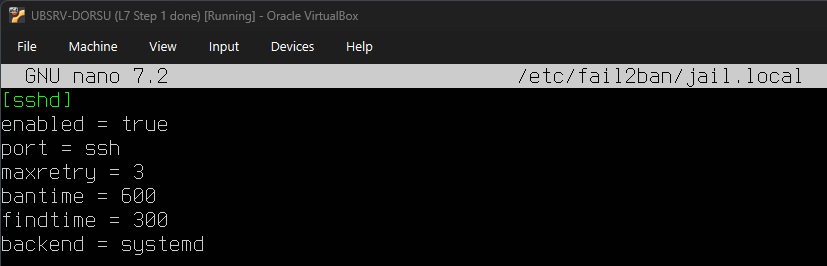

---

## Screenshot 4.2 — Fail2ban Service and Jail Status

Run:

```bash
sudo systemctl status fail2ban
sudo fail2ban-client status sshd
```

**Capture:** Fail2ban active and SSH jail enabled.

**Label:** `Figure 4.2 — Fail2ban SSH jail status`

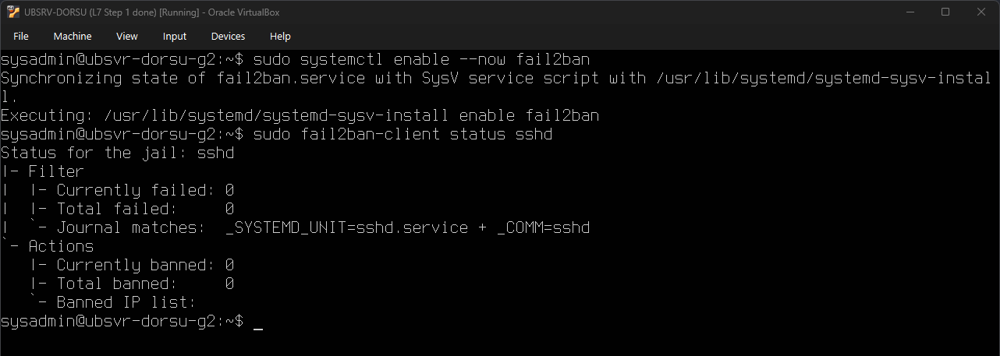

---

# Step 5 — Fail2ban Brute-Force Test

From the Windows guest:

```powershell
ssh wrongpass@192.168.10.12
```

Enter an incorrect password three times.

## Screenshot 5.1 — Failed SSH Attempts

**Capture:** Windows terminal showing the failed SSH login attempts.

**Label:** `Figure 5.1 — Three failed SSH login attempts`

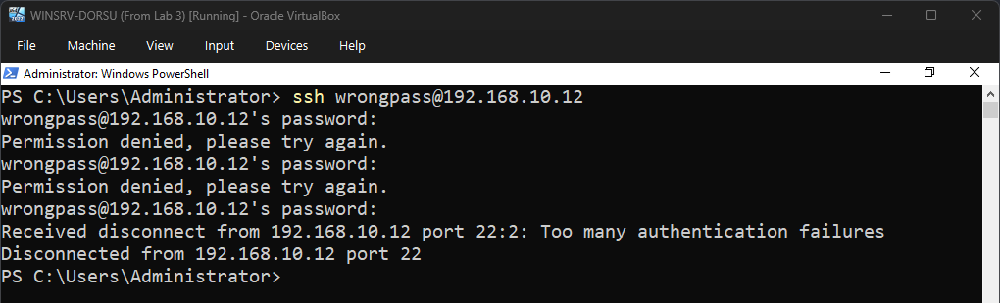

---

## Screenshot 5.2 — Fourth Attempt Blocked

Try SSH again:

```powershell
ssh wrongpass@192.168.10.12
```

**Capture:** Connection refused or timeout.

**Label:** `Figure 5.2 — SSH connection blocked after Fail2ban ban`

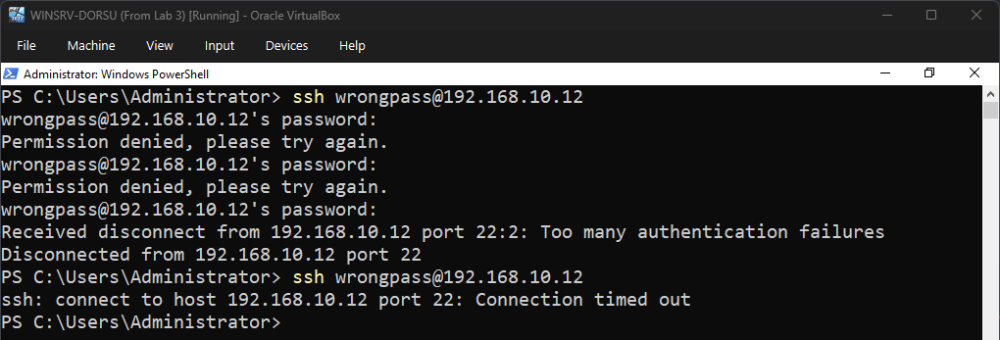

---

## Screenshot 5.3 — Confirm Banned IP

On Ubuntu:

```bash
sudo fail2ban-client status sshd
```

**Capture:** Windows guest IP shown in the banned IP list.

**Label:** `Figure 5.3 — Fail2ban banned IP evidence`

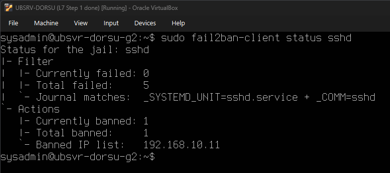

---

## Screenshot 5.4 — Unban the Windows Guest

Run:

```bash
sudo fail2ban-client set sshd unbanip 192.168.10.11
sudo fail2ban-client status sshd
```

**Capture:** IP removed from banned list.

**Label:** `Figure 5.4 — Fail2ban IP release`

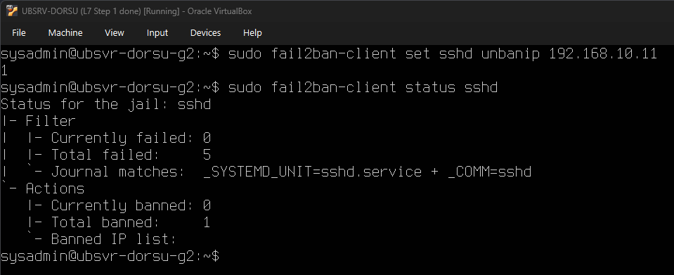

---

# Step 6 — Lynis Re-Audit

Run the **same audit command** used for the baseline:

```bash
sudo lynis audit system 2>&1 | sudo tee /var/log/lynis_after.log
```

## Screenshot 6.1 — Post-Hardening Lynis Audit

**Capture:** Completed audit.

**Label:** `Figure 6.1 — Lynis post-hardening audit`

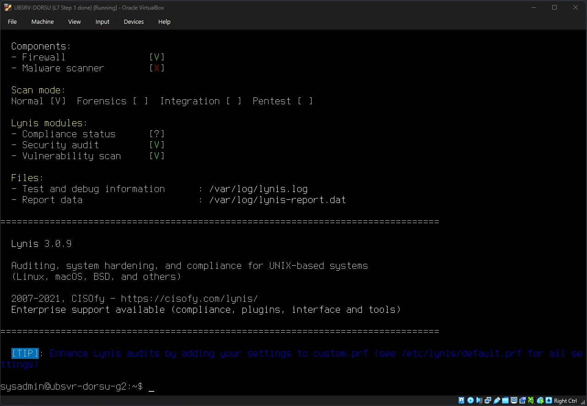

---

## Screenshot 6.2 — Post-Hardening Index

Run:

```bash
grep 'Hardening index' /var/log/lynis_after.log
```

**Capture:** New hardening index.

**Label:** `Figure 6.2 — Post-hardening index`

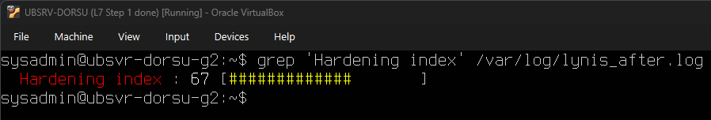

---

## Screenshot 6.3 — Baseline and After Comparison

Run:

```bash
grep 'Hardening index' /var/log/lynis_baseline.log
grep 'Hardening index' /var/log/lynis_after.log
```

**Capture:** Both values in the same terminal.

**Label:** `Figure 6.3 — Lynis before-and-after hardening indices`

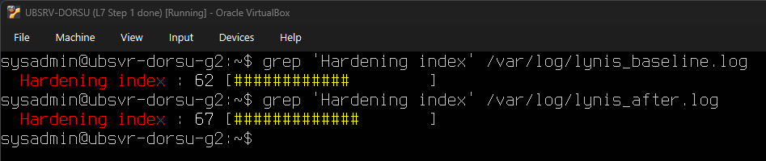

---

# Step 7 — Generate HTML Compliance Report

Create the script:

```bash
nano /home/sysadmin/gen_compliance_report.sh
```

The script must:

- use `set -Eeuo pipefail`
- extract both Lynis hardening indices
- show all ten CIS controls
- include the top five Lynis warnings
- generate `/var/www/html/compliance_report.html`

## Screenshot 7.1 — Compliance Report Script

**Capture:** Script contents.

**Label:** `Figure 7.1 — HTML compliance report generator script`

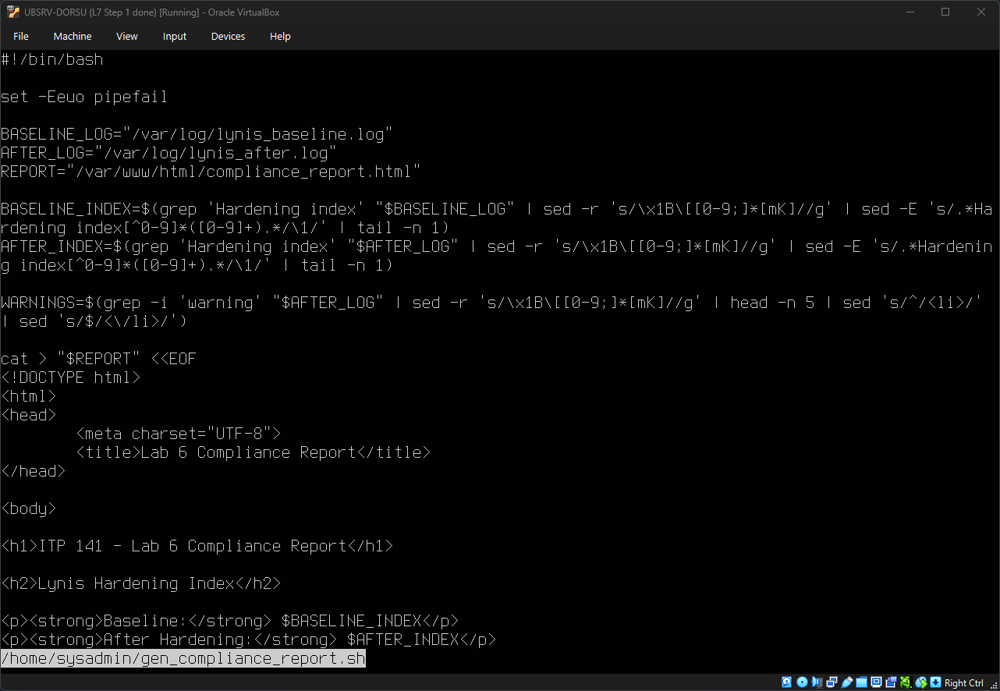 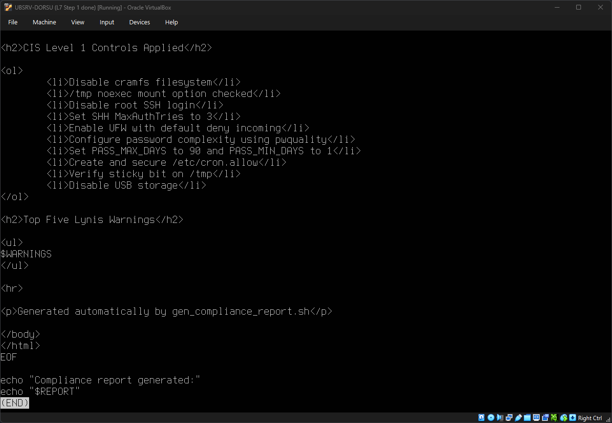

---

## Screenshot 7.2 — Execute the Report Script

Run:

```bash
sudo bash /home/sysadmin/gen_compliance_report.sh
```

Verify:

```bash
ls -l /var/www/html/compliance_report.html
```

**Label:** `Figure 7.2 — Compliance report generated`

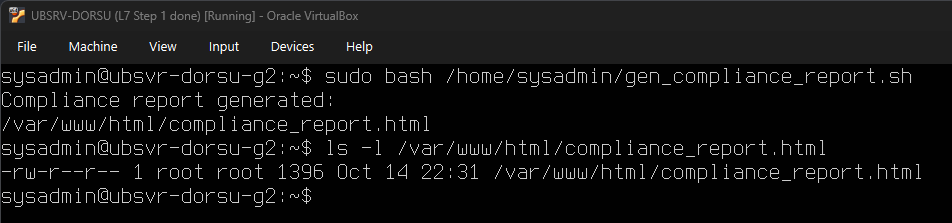

---

## Screenshot 7.3 — Install/Verify nginx

If nginx is not installed:

```bash
sudo apt install nginx -y
```

Verify:

```bash
sudo systemctl status nginx
```

**Label:** `Figure 7.3 — nginx web server status`

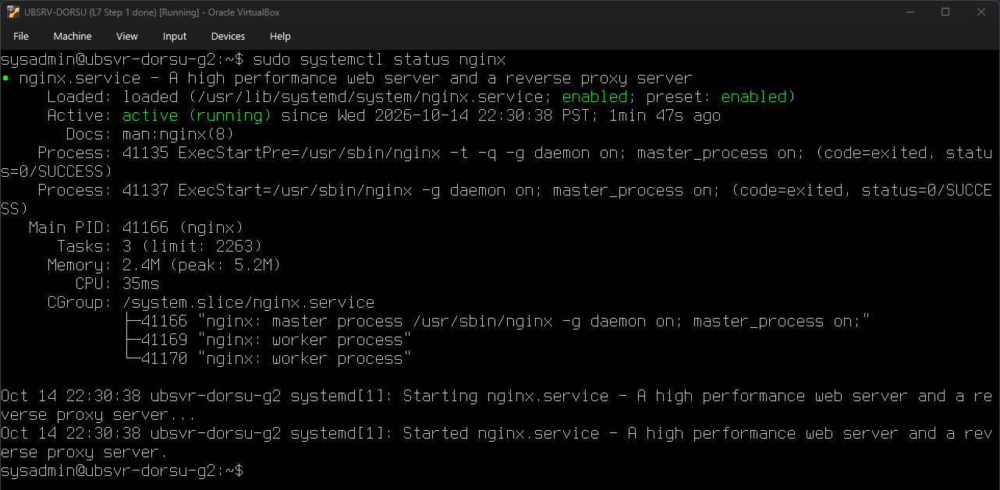

---

## Screenshot 7.4 — Open Compliance Report from Windows

On the Windows guest, browse to:

```text
http://192.168.10.12/compliance_report.html
```

**Capture:** Full browser view of the HTML compliance report.

**Label:** `Figure 7.4 — HTML compliance report viewed from Windows`

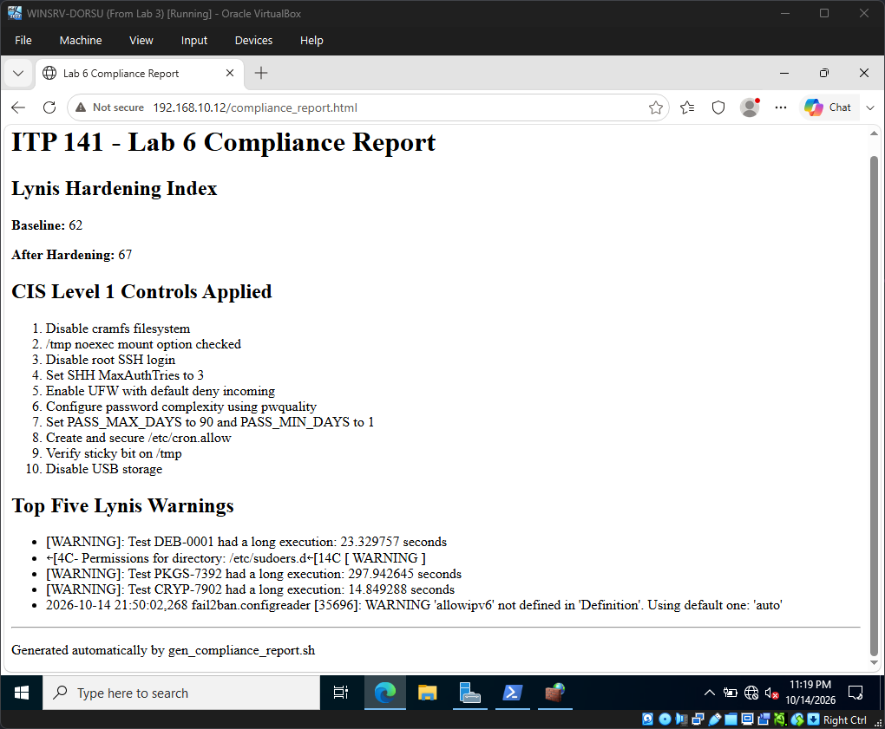

---
